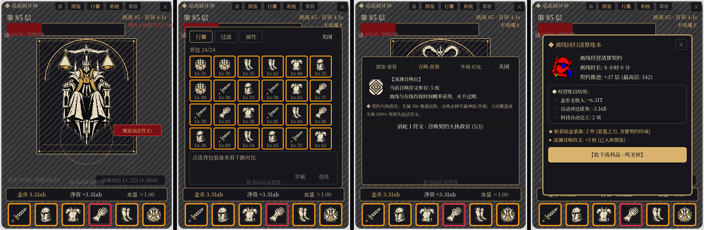
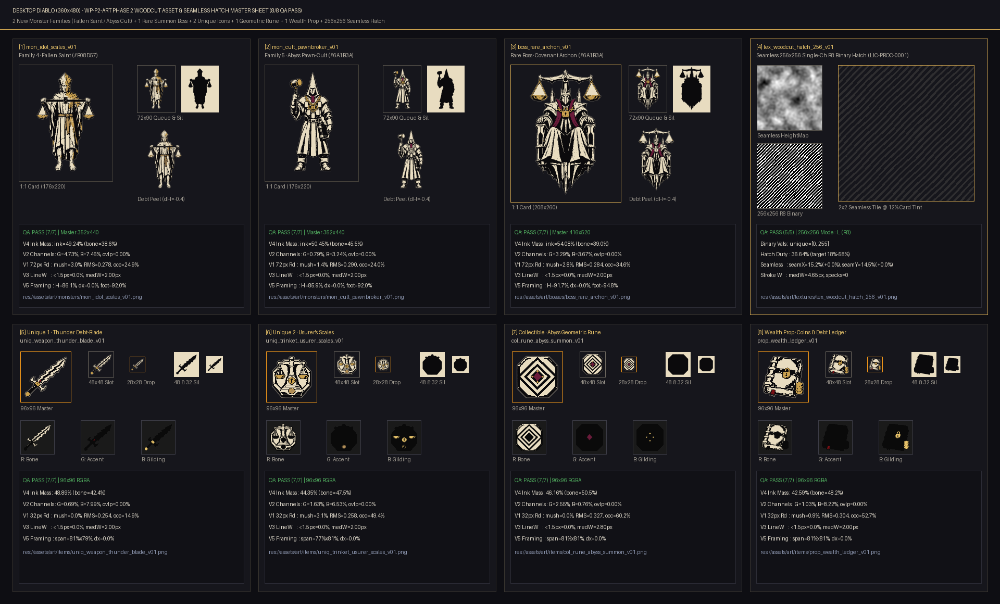
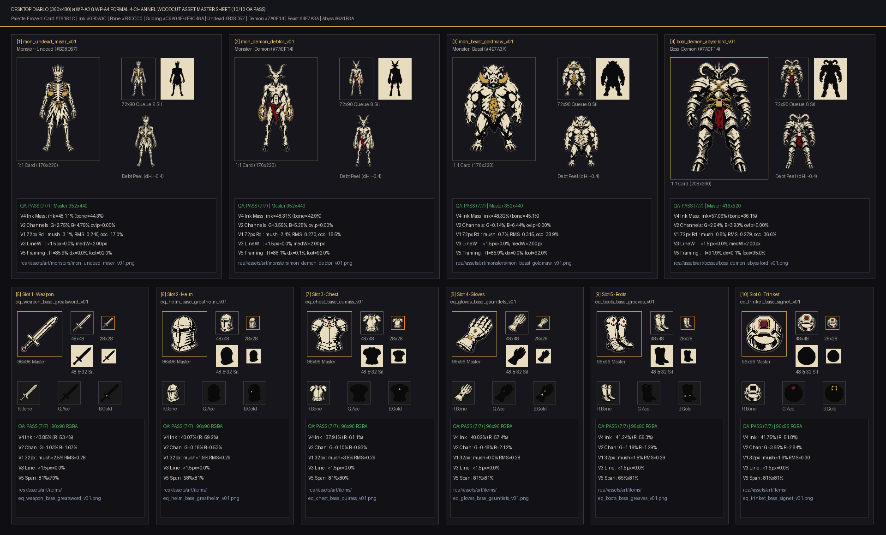
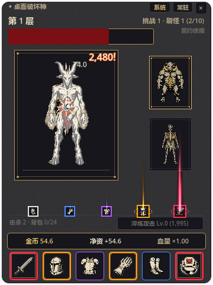
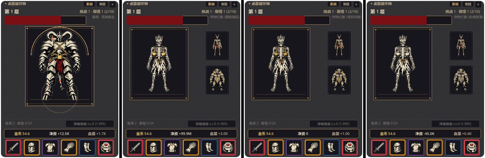
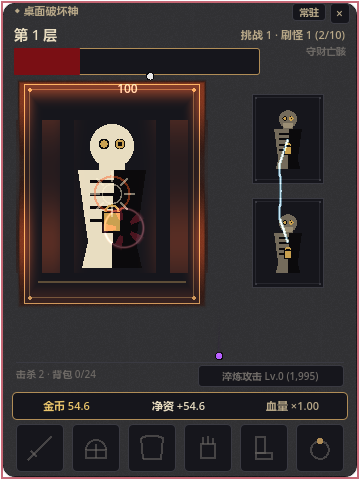

# 桌面破坏神 (Desktop Diablo)

> **Windows 桌面常驻 360×480 无边框透明置顶 ·「暗黑爆装 × 净财富信贷博弈 × 纯对数无限增量」挂机游戏**  
> 引擎：**Godot 4.7.2-stable (Standard / GL Compatibility / 30 FPS)** ｜ 视觉母题：**「镀金债契 · 骨白版画」(Gilded Debt Woodcut)**

---

## 1. 项目概览与核心循环

《桌面破坏神》是一款驻留在桌面一角的硬核数值增量与暗黑刷宝挂机游戏。游戏将**确定性高频战斗模拟**、**暗黑词条构筑（Build）**、**百层动态机制克制**、**净财富信贷博弈**与**深渊轮回收集**压缩进 `360×480` 的无边框透明小窗中，并以中世纪铜版画与高利贷羊皮债契为视觉语言，通过四通道数据纹理、无缝排线底纹与自定义 `palette_subject.gdshader` 实现受玩家净财富状态实时驱动的「骨白墨刻 × 债血鎏金」画面表现。

### 实机画面与资产检视

| 阶段 2 四态联排实机展示（执政官试炼 · 破壁高亮行囊 · 图鉴召唤台 · 回归账本卡） |
| :---: |
|  |

| 阶段 2 美术扩充包全量 8 件资产检视板 | 阶段 1 原型全量 10 件正式版画主体检视板 |
| :---: | :---: |
|  |  |

| 360×480 实机主窗口（版画渲染） | 深渊领主 Boss 战 & 净财富色调状态 | 暗金词条标志性 Shader 特效（震地 / 残影 / 光柱） |
| :---: | :---: | :---: |
|  |  |  |

---

## 2. 核心架构与阶段 1.5 + 阶段 2 完整系统特性

1. **纯对数大数引擎（`core/math/Num.gd`）**
   - 采用 `{sign: int, exp: float}` 对数表示法（`value = sign * 10^exp`），支持覆盖 `10^0` 至 `10^(10^300)` 的加减乘除、幂运算、比较与自适应单位格式化，彻底消除双精度浮点溢出。
2. **模拟层与表现层严格解耦（`simulation/` ↔ `presentation/`）**
   - `simulation/` 纯逻辑层零引擎节点依赖（纯 `RefCounted`），按 **10Hz（0.1s/tick）** 固定步长确定性推进；
   - `SimRng` 采用 SplitMix64 派生 `combat` / `loot` / `affix` 三路独立随机流，`10,000 ticks` 跨运行状态哈希严格一致（`ed736d348a333ce4d0f0a763e598d2647bb61b4d7529486bdecc68440f9daa4a`）；
   - UI 所有交互统一封装为 `Command` 入队，在 tick 边界原子消费，并用零副作用克隆 `DryRun` 计算六槽换装与稀有木桩测试的真实等效 DPS 差值。
3. **百层全机制池与动态克制（`BandRules.gd` / `MechanicDef.gd`）**
   - 覆盖 100–600+ 完整机制进阶：`100–199` 护盾（`shield`，单击削减上限）、`200–299` 反噬（`backlash`，普攻 40 层眩晕 2.0s）、`300–399` 只吃暴击（`crit_only`，非暴击 ×0.05）、`400–499` 分身（`split_boss`，Boss ≤50% HP 分裂 4 个分身）、`500–599` 吞金（`gold_devour`，存活期每秒吞金 1% 且绝不触碰储蓄托管）、`600+` 确定性双机制组合；
   - **30% 跨段余韵**：前一区间机制在下一区间保留 30% 残留强度；
   - **卡关归因与破壁高亮**：连败 5 次触发 `get_wall_hint()`，背包克制装备荧光高亮，并通过 `Signals.gd` 呈现窗口边缘五级优先级呼吸光带（`better_unique` > `prestige_ready` > `research_done` > `credit_tier_up` > `wall_hint`）。
4. **12 标志性词条与四重防递归保险（`AffixResolver.gd`）**
   - 涵盖连锁闪电 `chain_lightning`、落地即爆 `ground_slam`、杀戮狂热 `killing_frenzy`、处刑之锤 `executioner_hammer`、金币风暴 `gold_storm`、陨石 `meteor_shower`、终焉喷泉 `doomsday_fountain`、暴击余韵 `crit_afterglow`、暗金雨 `unique_rain`、碎盾连刺 `multi_strike`、致命宿命 `deadly_precision`、债契护印 `usurer_ward`；
   - 各机制均有 ≥2 个克制词条；内置因果掩码（Causal Chain Mask）、独立内置冷却、计数器累加与单步触发预算四重防无限递归死锁保护，经 100× 极限攻速压测稳定运行。
5. **净财富压力与动态信贷系统（`Wallet.gd` / `Credit.gd` / `TechTree.gd`）**
   - **净财富压力**：以 `W = gold - debt_total` 驱动承压系数（`0.40x ~ 3.00x`），彻底封死“借钱囤积不花以压低怪物强度”的套利空间；
   - **利用率平方溢价与自动抵扣**：贷款溢价率 `premium_rate(u) = 1.1 + 0.5 * u²`（`u = debt_principal / credit_limit`），战斗金币掉落最高 **40%** 自动抵扣未清债务；支持双笔并发贷款与信用升阶额度倍增；
   - **四分支 12 节点科技树**：涵盖战斗、经济、信贷、自动化（自动升级、自动还款、24h 离线上限），搭配 5 格串行 Unix 时间戳离线研究队列。
6. **双重轮回：灵魂转生与深渊轮回（`Prestige.gd` / `SimState.gd`）**
   - **灵魂转生**：`souls_gain = floor((max(0, max_stage - 80) / 20)^2.2)`，未清债务折算为 `legacy_debt_minutes` 结转下周目按 40% 收入偿还；
   - **深渊轮回与卡奈魔盒**：突破 100 层开启深渊转生获取印记 `marks`，解锁永久威能萃取台（`1 + floor(M/5)` 槽位），装配专属暗金词条并与 6 槽装备并列生效。
7. **永久独立图鉴 Codex 与稀有 Boss 召唤房（`Codex.gd` / `CodexSummonPanel.gd`）**
   - `user://codex.json` 独立原子持久化，跨周目永不清空；
   - 维护怪物、暗金、隐藏套装（雷霆断债套、贪婪契约套、深渊处刑套）、符文外观四大图鉴；每点亮 1 项永久提升 `+0.5%` 金币收益；
   - 消耗召唤符文切入**独立稀有首领「契约大执政官」**试炼（30s 倒计时、超时/主动撤退全额返还符文零损失、击败必掉专属神话暗金与外观）。
8. **30 检查点经验校准离线结算（`OfflineCalc.gd` / `ReturnReportModal.gd`）**
   - 离线推进采用真实 600 ticks 采样校准、30 段分段演化（包含到期研究结转、40% 还贷、财富重算、自动升级、Boss 推进判定、Poisson 稀有掉落与模拟时间符文生成）；严格执行 **Q23 不倒退铁律**；
   - 重启游戏弹出**「回归账本报告卡」**并伴随金币与圣钟喷泉结算。
9. **视听与桌面常驻体验补完（`SfxBank.gd` / `SystemTray.gd` / `DesktopWindow.gd`）**
   - **程序化 16-bit PCM 混音池**：13 种纯代码合成木刻音效 + 6 声道 `AudioStreamPlayer` 池与一键静音；
   - **思源宋体子集化**：`assets/fonts/NotoSerifSC-Subset.ttf`（3.17 MB，8,302 字符，SIL OFL 1.1）自适应排版；
   - **Windows 系统托盘常驻**：原生 `StatusIndicator` + 木刻盾章徽标，左键一键显隐，右键四项快捷菜单（显隐、静音、复位右下角、存档退出）；小窗隐藏期间 PresentationBus 自动排空零内存泄漏；
   - **Windows DWM 防黑底守卫**：安全探测 Win11 DWM 属性，锁定无边框逐像素透明通道，杜绝黑底异常。

---

## 3. 仓库目录与资源治理规范

```text
.
├── project.godot                # Godot 4.7.2 工程配置 (360×480, 无边框置顶透明, gl_compatibility, 30fps)
├── .gitattributes               # Git LFS 追踪规则 (art_source/{raw,anchors,rejected}/**/*.png)
├── .gitignore                   # 严格排除 .env、.godot/、*.tmp 与 art_source/thirdparty_raw/*
├── third_party_notices.txt      # PixelFX (MIT) 与 Noto Serif SC (SIL OFL 1.1) 完整许可证声明
├── README.md                    # 本项目完整技术规范与设计总览
├── docs/                        # 核心设计基准与工程验证文档
│   ├── 00_开发执行总纲.md        # 开发分包 (WP-00~17, WP-A1~A5)、勘误表与验收门禁总纲
│   ├── 02_系统架构与数值_v6.md   # 核心数学模型、架构分层、信贷/转生/存档规格
│   ├── 03_美术风格圣经_v1.0.md   # 「镀金债契·骨白版画」视觉规范与四通道着色协议
│   ├── 04_美术资产管线_v1.1.md   # AI 母图生成、四通道打包、7 项量化质检与溯源台账规范
│   └── verification_log.md      # 引擎特性、OpenAI 条款与许可证实测核验记录 ([V-01]~[V-04])
├── autoload/                    # 全局入口单例 (Game.gd)
├── core/                        # 纯数学与随机基础设施 (Num.gd, SimRng.gd, Clock.gd)
├── simulation/                  # 10Hz 纯确定性模拟核心 (Combat, LootRoller, AffixResolver, Credit, TechTree, BandRules, Signals, Collection)
├── content/                     # 游戏内容定义 (.tres)
│   ├── balance.tres             # 117 项带来源注释的权威数值常数
│   ├── affixes/                 # 12 标志性词条定义
│   ├── mechanics/               # 5 大百层机制定义 (shield, backlash, crit_only, split_boss, gold_devour)
│   ├── tech/                    # 4 分支 12 科技节点定义
│   ├── sets/                    # 3 套隐藏暗金套装定义
│   └── cosmetics/               # 外观与幻化定义
├── offline/                     # 30 检查点经验校准离线收益与不倒退保护 (OfflineCalc.gd)
├── persistence/                 # 原子保存服务 (SaveService.gd, Codex.gd)
├── presentation/                # 表现层总线、对象池、音效混音池 (SfxBank/SfxMixer)、战利品喷泉、Shader 特效 (VfxManager)
├── platform/                    # 桌面窗口管理、系统托盘常驻 (SystemTray.gd, DesktopWindow.gd)
├── ui/                          # 360×480 主界面与抽屉面板 (行囊过滤属性、信贷、科技、转生、图鉴召唤、回归报告卡)
├── assets/                      # 【进包正式资产】仅存放经 verify_manifest.py 校验通过的无损资产
│   ├── art/
│   │   ├── monsters/            # 五大族群版画数据纹理 (.png + .import)
│   │   ├── bosses/              # 深渊魔主与契约大执政官数据纹理
│   │   ├── items/               # 装备底材、专属暗金、召唤符文、财富插画图标
│   │   ├── textures/            # 无缝木刻等距排线底纹 (tex_woodcut_hatch_256_v01.png)
│   │   ├── vfx/                 # 16 帧灰度爆炸特效图集与元数据
│   │   └── shaders/             # palette_subject, loot_beam, sigil_ring, ground_slam, afterimage, shield_shatter, smelt_dissolve
│   └── fonts/                   # 思源宋体子集化字体 (NotoSerifSC-Subset.ttf)
├── art_source/                  # 【不进包源资产库】含 .gdignore，绝不进入导出 .pck
│   ├── manifest.csv             # 19 件美术资产 SHA-256 与工具链溯源台账 (pre-commit 强制校验)
│   ├── licenses/                # LICENSES.csv、许可凭证与 OFL-1.1 全文
│   ├── prompts/                 # 17 件正式与锚点资产 YAML 生成提示词
│   ├── anchors/                 # [Git LFS] 冻结的视觉锚点母图归档
│   ├── raw/                     # [Git LFS] 原始高分辨率母图归档
│   ├── rejected/                # [Git LFS] 质检退稿样本归档
│   └── thirdparty_raw/          # [.gitignore 排除] 本地第三方原始未加工素材缓存（严禁入库）
├── tools/                       # 数值仿真与美术自动化管线工具
│   ├── curve_sim.gd             # Gate-1 三剧本×30种子数值曲线仿真器
│   ├── art/                     # 美术生成、排线化 (hatch_from_height)、四通道打包、7项QA、检视板与 manifest 门禁
│   └── out/                     # 数值报告、实机验收截图与资产 QA 检视板 (含 .gdignore)
└── tests/                       # 23 个 Headless 自动化单元与集成测试套件 (run_all.gd)
```

---

## 4. 环境依赖与常用命令

### 环境要求

- **Godot Engine**：`4.7.2-stable` 标准版（Standard Win64，非 `.NET` 版）
- **Python**：`>= 3.11`（依赖：`Pillow`、`numpy`、`scikit-image`、`opencv-python-headless`、`openai`、`pyyaml`）
- **Git & Git LFS**：`git >= 2.40`、`git-lfs >= 3.0`
- **Node.js**：`>= 20`（仅离线导出 PixelFX 原始帧序列时可选使用）

### 1) 启动桌面实机小窗

```powershell
# 使用 Godot 4.7.2 启动桌面常驻 360×480 透明小窗
& "F:\Godot\4.7.2\Godot_v4.7.2-stable_win64.exe" --path "F:\挂机游戏制作"
```

### 2) 运行全量 23 套件 Headless 自动化测试

```powershell
& "F:\Godot\4.7.2\Godot_v4.7.2-stable_win64_console.exe" --headless --path "F:\挂机游戏制作" --script res://tests/run_all.gd
```

测试覆盖：
`Num` 对数大数库、`Balance` 117 项数值模型、`CombatSim` 10,000 ticks 确定性哈希、掉落与 24 格背包、净财富钱包、表现层对象池与音效预算、词条解析器与四重防递归保险、信贷溢价与自动抵扣、科技树研究队列、100 层过路费与护盾机制、灵魂转生与原子存档、`curve_sim` 仿真器、桌面窗口交互、词条 Shader VFX、D5/D6 UI 抽屉、正式版画美术集成、**Phase 2 模拟内核与深渊轮回**、**Phase 1.5 音频混音池与微特效**、**思源宋体子集化与系统托盘常驻**、**稀有收藏与 Codex 永久图鉴**、**百层机制与卡墙高亮 UI**、**图鉴召唤台与回归账本卡 UI**（共 **`23 / 23`** 全部通过）。

### 3) 运行 Gate-1 数值曲线仿真

```powershell
& "F:\Godot\4.7.2\Godot_v4.7.2-stable_win64_console.exe" --headless --path "F:\挂机游戏制作" --script res://tools/curve_sim.gd -- --strict-gate
```

### 4) 运行美术资产台账与合规门禁校验

```powershell
python tools/art/verify_manifest.py
```

### 5) 导出二期四态实机全景图（需活动显示环境）

```powershell
& "F:\Godot\4.7.2\Godot_v4.7.2-stable_win64_console.exe" --path "F:\挂机游戏制作" --capture-p2-showcase=tools/out/wp_p2_live_showcase.png --capture-after-sec=0.8
```

---

## 5. 第三方开源许可与预生成 AI 资产合规披露

本项目严格遵守开源软件许可与 Steam 等数字发行平台关于预生成 AI 资产的披露规范，完整声明与许可证全文见根目录 [`third_party_notices.txt`](third_party_notices.txt) 与 [`art_source/licenses/LICENSES.csv`](art_source/licenses/LICENSES.csv)：

1. **PixelFX 爆炸特效序列（MIT License）**
   - 来源：[`patch-gg/pixelfx`](https://github.com/patch-gg/pixelfx)（Commit `5294518ce7c72e48b6100a744596e0acf57f2826`），仅使用 `small-explosion.js` 归一化灰度遮罩，专有字体 `PatchPixel` **已严格排除**。
2. **思源宋体 / Noto Serif SC（SIL Open Font License 1.1）**
   - 来源：Google Fonts / Adobe Source Han Serif，经项目定制纯 Python 工具静态实例化 `wght=500` 并子集化为 3.17 MB 轻量嵌入字体（8,302 字符），许可证全文归档于 [`art_source/licenses/texts/OFL-1.1-NotoSerifSC.txt`](art_source/licenses/texts/OFL-1.1-NotoSerifSC.txt)。
3. **预生成美术底图说明（Pre-Generated AI Content Disclosure）**
   - `assets/art/` 下的 18 件主体与道具底图由项目组在研发期通过 OpenAI Images API（商业使用权归属依据 OpenAI Business Terms §3.1）基于原创版画提示词离线生成，提示词不含任何在世艺术家姓名或第三方受版权保护 IP；
   - 底图经自研形态学算法（`process_subject.py`）去除背景并编码为 R/G/B/A 四通道版画数据纹理，排线底纹由自研傅里叶算法（`hatch_from_height.py`）程序化生成，**游戏运行时 100% 离线，无任何生成式 AI 调用**。
