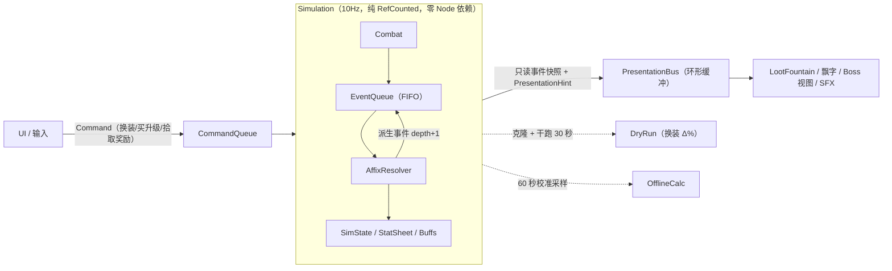
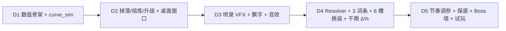
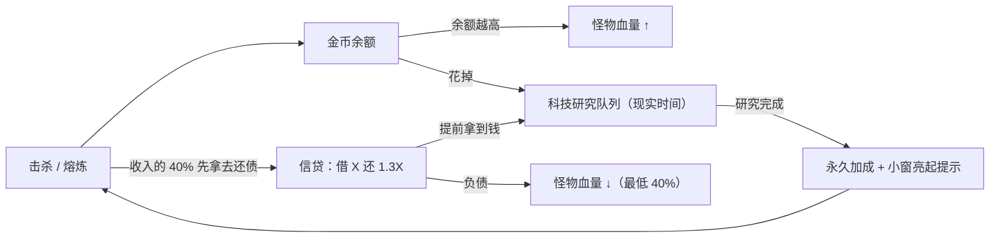

# 《桌面破坏神》：桌面常驻「暗黑爆装 × 纯数值增量」无限挂机游戏 — 系统架构与原型方案 v6（动工基准见 §9）

> 证据等级：**[C]** Canonical（引擎事实或数学恒等式）· **[I]** Inference（设计推导，要靠 `curve_sim` 实测校准）· **[U]** Unknown（需要在目标机器上实测）。
>
> **v2 变更**：产品定位从“30 分钟快餐曲线”改为**无尽长线 + 多层嵌套转生**。重写了 §0、§1、§3.4、§4；原 Q1、Q4、Q15 作废，分别由 Q18、Q19–Q21、Q16 取代。
>
> **v3 变更**：回访节奏改为“零损失、随时瞥一眼”；新增 **§5 金币压力 × 信贷 × 科技树**（核心差异化）。按 Q22，全文已不再使用“粉尘”，统一为“金币”。

## 0. 已锁定的决策

| # | 决策点 | 结论 |
|---|---|---|
| Q1→**Q18** | 语言与大数 | GDScript 全栈；**所有会无限膨胀的量都存成 log10 浮点数**（上限约 10^(10^308)），概率、攻速这类有上限的量仍用普通 float，统一走 `Num` 封装 |
| Q2 | 新装备的意义 | 装备有 iLvl，基础区随 iLvl 指数增长；金币提供加法区；暗金词条各开独立乘区 |
| Q3 | 推层 | 层数**无上限**；每层 10 只小怪 + 15 秒限时 Boss；打不过就自动退回上一层刷，变强后自动重试 |
| Q4→**Q19/Q20** | 转生 | 嵌套三层：灵魂（数小时一次）→ 深渊印记（数天一次）→ 第三层（更长，第三阶段再设计） |
| Q5 | 时钟与离线 | 10Hz 确定性 Sim；离线用经验校准法外推，上限 8h，可用灵魂升级到 24h |
| Q6 | 结算粒度 | 每 tick 前 8 次攻击逐次结算，其余按二项分布聚合；溢出伤害穿透到下一只怪；每 tick 最多击杀 20 只 |
| Q7 | 防递归 | 延迟 FIFO 队列 + 深度上限 4 + 因果链掩码 + 每词条每 tick 预算 + 全局每 tick 事件上限 |
| Q8 | 词条数据 | 用 Resource 组合：`AffixDef = Trigger + Effect + 数值区间` |
| Q9 | 磨砂效果 | 先做伪磨砂，第二阶段接 DWM Acrylic |
| Q10 | 帧率 | 固定 30fps，不分功耗档 |
| Q11 | 掉落物理 | 自写弹道 + 对象池（上限 120），超出部分变成“+N 金币” |
| Q12 | 掉落归属 | 以 Sim 结果为准；手动拾取的奖励走 `Command` |
| Q13 | 过滤 | 按品质 ≥ X 保留；紫装熔成高阶源质；背包 24 格 |
| Q14 | 换装 | 手动换，界面显示干跑得出的 Δ% |
| Q15→**Q16** | 节奏 | **没有终点，无限循环**。“前 5 分钟 100→1e7”只作为首周目开局的钩子 |
| **Q19** | 灵魂周目 | 首周目约 2 小时撞软墙；之后每周目先用几分钟推回上次纪录，再花 1–3 小时破纪录；玩家自己决定何时转生 |
| **Q20** ✅ | 深渊转生 | **清空**：全部装备、金币、灵魂、层数。**永久保留**：科技树、图鉴、收藏记录、外观、已萃取的威能。每次深渊转生萃取 1 条威能进永久槽（卡奈魔盒式），同时解锁新的词条池和怪物机制 |
| **Q21** | 自动化 | ~~按转生次数解锁~~ → 已被 Q28 取代：整体并入科技树的“自动化”分支；**换装和萃取永远手动** |
| **Q22** | 货币 | 只保留一种货币「金币」，取代粉尘。熔炼得金币，升级和科技树都花金币 |
| **Q23** ✅ | 财富与怪物血量 | 保留财富压力机制，**普通财富压力最多让怪物血量 ×3**；花钱（余额下降）和负债都会降低怪物血量；**离线进度绝不倒退**。具体参数通过模拟校准（§5.1） |
| ~~Q24~~ | ~~魔鬼契约~~ | **作废**：到期没收抵押物是惩罚，违反 Q25“不玩不吃亏”的原则 |
| **Q25** | 回访节奏 | **小窗常驻，想看就瞥一眼看热闹；没有任何紧急决策，几天不看也零损失** |
| **Q26** ✅ | 赊账代价 | 收入抵扣制，溢价 **`1.1 + 0.5u²`**（u = 借款额 / 额度，借满时还 1.6 倍），**借款前先展示总还款额**；不按现实时间计息；每笔收入自动扣 40% 还债；欠债期间怪物变弱；还清后信用升级；转生时未还清的债按比例扣灵魂 |
| **Q27** | 科技解锁 | 花金币 + 等研究时间（从几分钟到一两天）；研究队列 5 格；研究完成时，小窗亮起提示 |
| **Q28** | 科技树归属 | **永不重置**，是长线的主轴。分四个分支：战斗 / 经济 / 信贷 / 自动化；深渊印记解锁更深一层的分支 |
| **Q29** | 特效词条 | 词条效果就是特效：每条特效词条都在 Sim 里真实生效，并配有独有的视觉签名；由 VFX 预算管理器统一合并降级，保证 30fps（§6） |
| **Q30** | 无血条反伤 | 玩家没有血条，永远不会“死亡”。反伤改为“反噬值”：攻击会累积反噬，攒满后眩晕 2 秒。**所有关卡墙都只限制杀怪效率**（§7） |
| **Q31** | 机制变阵 | 每 100 层换一个“主题机制”（满强度），上一区间的机制保留 30% 强度。前 500 层按你给的固定顺序；500 层以后从机制池里两两组合轮换（§7） |
| **Q32** | 关卡门票 | 只在每 100 层分界处设门票：净资产（金币 − 负债）≥ 门票才能进入下一区间；门票会真实扣除；钱够时自动交；靠近门口时进入储蓄模式（§7.3） |
| **Q33** | 稀有 Boss | 不直接刷出，而是掉落“召唤符文”，存进图鉴，永不过期，由玩家自己选时机召唤（§8） |
| **Q34** | 收藏回报 | 图鉴永久保留；每点亮一项给一点小加成；集齐一页解锁外观；太古外观可以幻化到其他装备上；隐藏套装只能靠自己发现（§8） |
| **Q35** ✅ | 转生时的债务 | 债务永远不会凭空消失：未还清的部分换算成“宿债时长”带进新周目，继续按收入的 40% 抵扣；灵魂和印记不打折（§5.2） |
| **Q36** ✅ | 门票托管 | 储蓄模式下，收入存入锁定的托管账户，只能用来交门票，不计入财富压力；验收标准：零操作玩家等门时间中位数 ≤ 1 小时、P90 ≤ 4 小时（§7.3、§9.2） |
| 修复 ✅ | 净财富 | 财富压力统一按净财富计算：W = 金币 − 应还总额（不含托管账户），借钱不会再被误判为“变富” |

> [!IMPORTANT]
> **v3 产品定位修正（以此为准）**：这不是一个需要“碎片时间切回来操作”的游戏，而是**“丢几天也安全，但让人忍不住想瞥一眼”**的游戏。
> - 游戏里不设任何惩罚性的倒计时，不没收任何东西，也没有错过就再也拿不到的内容。
> - 吸引玩家回来看看，靠的全是“有好事在等你”：研究完成了、新暗金进背包了、卡在墙前等你换 Build、债还清后信用升级了、可以转生了。

> [!NOTE]
> 设计主张：灵魂转生时**保留身上 6 件装备**。下一周目开局，这些高 iLvl 装备的平值会碾压前几十层，“几分钟推回旧纪录”就是靠这一点实现的。深渊印记会清空装备，长线追求随之从“堆数值”转向“收集和组合威能”。

> [!NOTE]
> Q10 的正确性提示仍然有效：窗口最小化时，`PresentationBus` 每帧都要照常消费并合并，否则恢复窗口时会一次性喷出几千件掉落。

---

## 1. 无尽数值模型（log10 域）

### 1.1 为什么用 log10 域 [C]

所有会无限膨胀的量都用 \(x = \log_{10} X\) 来存。

| 运算 | log 域写法 | 成本 |
|---|---|---|
| 乘、除 | `x + y`、`x − y` | 一次浮点运算，**乘区直接变成加法** |
| 幂 | `x · k` | 一次浮点运算 |
| 加 | `max + log10(1 + 10^(min − max))`；两者相差 > 17 时直接取 `max` | 一次 `pow` + 一次 `log` |
| 零 | `-INF` | — |
| 精度 | 当 x ≈ 1e6（数值约 10^1,000,000）时，相对误差约 5e-10 | 足够 |

- 工程上不分配任何对象；`Num.gd` 只是一组 `static func`，外加格式化：< 1e6 时加千分位，然后用 K/M/B/T/aa…，再大就切到 `1.23e4567`，最后是 `ee` 记法。
- 有上限的量（暴击率、攻速、MF、计数器）**禁止**进 log 域，以免误用。

### 1.2 单次伤害公式（log 域写法）[I]

$$
d_{hit} = \log_{10}\!\Big(B_{gold} + \sum_{i=1}^{6} F_i\Big) + \log_{10}\!\Big(1 + P\Big) + \sum_j \log_{10}(1+m_j) + s_{soul} + a_{abyss} + \log_{10} C
$$

| 区 | 公式 | 说明 |
|---|---|---|
| 基础区 | `log B_gold = log B0 + L·log β`，β = 1.14；`log F(iLvl) = log(φ·B0) + iLvl·log g`，g ≈ 1.40 | 装备落后 7 层后，相对价值只剩约 10%，所以旧装备会自然过时 |
| 加法区 | 金币 % + 装备 % | 越堆越被稀释，收益天然递减 |
| 暗金乘区 | 每件 ×1.5–×3 | 6 个槽位，加上深渊永久威能槽 |
| 灵魂区 | \(s_{soul} = \log_{10}(1 + 0.1 \cdot \text{souls})\) | 见 §1.4 |
| 深渊区 | 不直接乘伤害，而是**放大灵魂获取的指数**（见 §1.5） | 嵌套层的本质：抬高下一层的天花板 |

### 1.3 怪物血量：log 域二次曲线制造“利息递减”[I]

$$
h(s) = \log_{10} 150 + 0.2\,s + a\,s^2,\quad a = 0.0005
$$

- **前期**：二次项可以忽略。第 25 层的缺口只有 \(0.0005 \cdot 625 = 0.31\)（约 ×2），所以“5 分钟到 1e7”的开局爆发保持不变。
- **中期**：第 55 层缺口约 1.5（约 ×30），需要靠装备和暗金来补。对应“30 分钟后明显变慢”。
- **软墙**：如果一个周目里装备和暗金最多能补 \(W \approx 3\)（×1000）的缺口，墙就出现在 \(s = \sqrt{W/a} \approx 77\) 层附近，对应首周目约 2 小时。
- 金币带来的成长在 log 域里随层数线性增长，而血量是二次增长，所以**无论金币怎么涨，墙都一定会出现** [C]。这正是转生存在的数学理由。
- 每 100 层从“深渊怪物词条池”里抽一个新机制（比如护盾、减伤、只吃触发伤害），让墙不只是数值墙，也是构筑墙。

### 1.4 第一层：灵魂 [I]

- 单次转生获得灵魂：\(\text{souls} = 10^{\,k\,(s_{rec} - 50)}\)，\(k = 0.05\)。灵魂数随新纪录层数指数增长，因此 \(s_{soul} \approx k \cdot s_{rec}\)，在 log 域里是线性的。
- **不动点推导** [C，在该模型下严格成立]：下一周目能推到的层数满足 \(a s^2 = W + k\,s\)，所以
$$
s_\infty = \frac{k + \sqrt{k^2 + 4aW}}{2a} \approx 142\ \text{层}
$$
- **“利息递减”的含义**：每次转生都能推得更深，但增量越来越小，最终收敛到大约 142 层。按每周目 1–3 小时计算，大约 10–20 个周目（约 2–4 天）后，灵魂层的收益会明显变平，这时玩家自然会进行深渊印记转生。这和 Q20“几天一次”是同一件事。

### 1.5 第二层：深渊印记——抬高第一层的天花板 [I]

- 印记效果：\(k = 0.05\,(1 + 0.2M)\)，M 是累计印记数。
- 本次获得印记：\(\Delta M = \lfloor (s_{rec}/100)^{1.5} \rfloor\)。
- k 足够大时，\(s_\infty \approx k/a = 100\,(1 + 0.2M)\)。也就是说，**天花板随 M 线性抬高，而 M 的获取随纪录层数次线性增长 → 整体呈多项式增长，不会封顶，增速逐渐放缓**。这就是“无限循环但利息递减”的精确数学形态。
- 第三层（第三阶段）用同样的套路：它的产出放大 \(\Delta M\) 公式的指数。每多嵌套一层，就抬高下面一层的不动点。
- 卡奈式萃取：每次深渊转生萃取 1 条威能，永久槽位数为 `1 + floor(M/5)`。威能的“收藏”和“组合”就是数值之外的第二条长线。

### 1.6 自动转生的默认条件 [C：最优停止的经典判据]

当“本周目灵魂获取速率”`souls_pending / run_time` 越过峰值开始下降时转生，这样可以让每小时的灵魂收益最大。玩家也可以改用“到达第 N 层”或“运行满 T 小时”作为条件。

### 1.7 掉落与 MF（沿用 v1）[I]

- 每次击杀掉落 1.2 × (1 + 数量加成) 件，单次上限 30 件。
- 品质权重：白 70 / 蓝 22 / 紫 7 / 暗金 0.9 / 太古 0.1。
- MF 采用 D2 式递减：`MF_eff = MF·250/(MF+250)`。
- 暗金保底：连续 140 次击杀未出暗金就必出（只用于首周目的 75 秒节点）。
- 深渊层数越高，开放的词条池越多；太古绯红 = 满 roll + iLvl+5 + 额外 1 条词条。

> [!IMPORTANT]
> **第 1 天的 `curve_sim` 需要两种模式**：
> - **tick 模式**：用真实 Sim 跑首周目的 2 小时，校准 §1.2 和 §1.3。
> - **抽象快进模式**：按层而不是按 tick 计算，带自动转生策略，模拟 30 天游戏时间，画出“纪录层数 / 灵魂 / 印记 – 天数”曲线，验证 §1.4–1.5 的不动点和多项式增长。
>
> 以上常数全部是纸面推导，要以实测为准。

---

## 2. 事件与词条结算管线

### 2.1 分层与数据流



规则 [C，架构约束]：
1. 表现层**只读** Sim；所有改动都通过 `Command` 发回 Sim。
2. Sim 不 `import` 任何 `Node`，因此可以克隆、可以在 headless 下运行、可以干跑。
3. 随机数拆成 `combat` / `loot` 两条种子流，保证干跑对比和回放的确定性。

### 2.2 事件结构

```gdscript
# simulation/events/sim_event.gd
class_name SimEvent extends RefCounted
enum T { HIT, CRIT, KILL, BOSS_KILL, DROP, SMELT, METEOR, TIMER, STAGE_UP }
var type: T
var count: int = 1          # 聚合事件的件数（50 次熔炼可以合成一个事件）
var value: float = 0.0      # 伤害量、金币量等
var payload: Dictionary     # 稀有物品实例等
var depth: int = 0          # 派生深度
var chain_mask: int = 0     # 因果链上已经触发过的词条实例位（6 槽 × 4 条 = 24 位，用 int64 足够）
var hint: Dictionary        # 只给表现层用的提示，比如 {launch_mul = 1.2}
```

### 2.3 Resolver 核心循环（四重保险）

```gdscript
# simulation/events/affix_resolver.gd
const MAX_DEPTH := 4
const MAX_EVENTS_PER_TICK := 256
const MAX_SPILL := 512

func run_tick(state: SimState) -> void:
    for l in listeners: l.tick_budget = l.def.budget_per_tick   # ③ 每词条每 tick 预算
    var processed := 0
    while not queue.is_empty() and processed < MAX_EVENTS_PER_TICK:  # ④ 全局上限
        var ev: SimEvent = queue.pop_front()
        processed += 1
        core_rules.apply(ev, state)          # 基础规则：扣血 / 掉落 / 熔炼 / 入账
        presentation_bus.push(ev)
        for l in listeners_by_type.get(ev.type, []):   # 按 槽位→词条 顺序排好，保证确定性
            if ev.chain_mask & l.bit: continue           # ② 同一条因果链上只触发一次
            if l.tick_budget <= 0: continue
            var fires := l.def.trigger.consume(ev, l.runtime)  # 计数器 / 概率 / 内置 CD，返回触发次数
            fires = mini(fires, l.tick_budget)
            l.tick_budget -= fires
            for k in fires:
                for out in l.def.effect.execute(ev, state, l.rolls):
                    out.depth = ev.depth + 1
                    out.chain_mask = ev.chain_mask | l.bit
                    if out.depth > MAX_DEPTH:            # ① 深度上限 → 转成溢出奖励
                        state.overflow_reward(out); continue
                    queue.push_back(out)
    if queue.size() > MAX_SPILL:
        queue = EventCompactor.merge_by_type(queue)      # 同类事件合并 count，绝不丢计数
```

几个要点：
- **计数型触发器不丢数**：`Trigger.consume` 先把 `ev.count` 累加进 `runtime.acc`，触发次数 = `acc / 50`，余数保留。一次熔炼 120 件就触发 2 次，剩下 20 件留到下次。
- **闭环可以出现，但必然收敛**：熔炼 →(陨石)→ 击杀 →(暴击余韵)→ 掉落 → 熔炼。走到“熔炼”这一步时，陨石词条的位已经在 `chain_mask` 里，所以这条链停下 [C：每条链上每个词条最多出现一次，24 个词条实例 ⇒ 链长 ≤ 24，再被深度 4 截断]。
- **两类词条分开处理**：
  - **被动型**（加乘区）只修改 `StatSheet`，只在换装或升级时重算一次（dirty 标记），**不进入事件总线**。
  - **反应型**才注册成 listener。
- **临时效果**统一成 `Buff`，包含 `duration_ticks` / `charges` / `stacks` 三种计量方式。

### 2.4 用 Resource 定义你给的三个示例词条

| 词条 | Trigger | Effect |
|---|---|---|
| 每熔炼 50 件 → 陨石秒杀 Boss | `on=SMELT, mode=COUNTER, n=50` | `EmitEvent(METEOR, pct_max_hp=1.0)`；深渊 Boss 只吃 25% |
| 暴击 → 喷射高度 & 额外掉落 +20% | `on=CRIT, mode=ALWAYS, icd=5 ticks` | `AddBuff("余韵", stacks≤5, 3s, drop_qty+20%/层, hint.launch_mul=1.2)` |
| 挂机满 3 分钟 → 下一击杀暗金雨 ×10 | `on=TIMER, period=1800 ticks` | `AddCharge("暗金雨", on_next=KILL, drop_count×10, rarity_floor=紫)` |

---

## 3. Godot 4 工程结构与桌面窗口

### 3.1 目录

```
res://
├─ autoload/Game.gd                 # 唯一的 autoload：持有 SimRunner、SaveService、PresentationBus
├─ core/                            # 纯工具层，零游戏逻辑
│  ├─ num/Num.gd                    # 大数封装：运算 + 格式化（1.23M / 4.5e12），以后替换只改这里
│  ├─ rng/SimRng.gd
│  └─ pool/ObjectPool.gd
├─ simulation/                      # 纯 RefCounted，可 headless 运行、可克隆
│  ├─ SimState.gd  SimRunner.gd  StatSheet.gd  Balance.gd
│  ├─ combat/Combat.gd  Spawner.gd
│  ├─ loot/LootRoller.gd  Smelter.gd  Inventory.gd  Filter.gd
│  ├─ progression/Upgrades.gd  Prestige.gd(第二阶段)
│  ├─ events/SimEvent.gd  EventQueue.gd  AffixResolver.gd  EventCompactor.gd  Buffs.gd
│  ├─ affix/AffixDef.gd  TriggerDef.gd  EffectDef.gd  effects/*.gd
│  └─ commands/Command.gd  DryRun.gd
├─ offline/OfflineCalc.gd
├─ persistence/SaveService.gd       # JSON + version 字段 + 原子写入（先写 tmp 再 rename）
├─ content/                         # 纯数据：affixes/*.tres  item_bases/*.tres  balance.tres
├─ presentation/
│  ├─ PresentationBus.gd            # 环形缓冲：Sim → View
│  ├─ battle/MonsterView.tscn  FloatingTextLayer.gd
│  ├─ loot/LootFountain.gd  LootSprite.tscn  beam.gdshader
│  └─ audio/SfxMixer.gd
├─ ui/MainWindow.tscn  Hud  UpgradePanel  EquipSlots  Inventory  Tooltip
├─ platform/DesktopWindow.gd        # 无边框、置顶、透明、拖拽、贴边吸附、记忆窗口位置
└─ tools/curve_sim.gd               # godot --headless --script res://tools/curve_sim.gd
```

### 3.2 SimRunner（固定步长 + 睡眠 / 长间隔处理）

```gdscript
const TICK := 0.1
const MAX_CATCHUP_TICKS := 50          # 最多补 5 秒
var _acc := 0.0
func _process(delta: float) -> void:   # 挂在 Game autoload 上
    _acc += delta
    if _acc > MAX_CATCHUP_TICKS * TICK:          # 系统睡眠、卡顿超过 5 秒
        OfflineCalc.settle(state, _acc); _acc = 0.0; return
    while _acc >= TICK:
        _acc -= TICK
        sim.step()                                 # 先处理 commands → combat → resolver → buff 计时
```

### 3.3 桌面窗口配置

**`project.godot` 里需要设置的项 [C]：**
- `display/window/size/viewport_width=360`, `viewport_height=480`
- `display/window/size/borderless=true`
- `display/window/size/always_on_top=true`
- `display/window/size/transparent=true`
- `display/window/per_pixel_transparency/allowed=true`
- `rendering/viewport/transparent_background=true`
- `application/run/max_fps=30`
- 渲染器选 **Compatibility**（OpenGL，开销最低）

**窗口拖拽**：在顶部 24px 的标题区域里，按住鼠标时记录偏移，然后调用 `DisplayServer.window_set_position(mouse_global − offset)`，松手后吸附到最近的屏幕角，并把位置写进存档。
- 4.4 及以上版本可以试试原生的 `window_start_drag()`，**[U] 请以你安装的版本文档为准**，手动拖拽作为兜底。

**伪磨砂实现**：根节点 `Panel` 用 `StyleBoxFlat`，背景色 `#0E0F14`、α 0.85、圆角 12，叠一层 3% 不透明度的平铺噪点纹理，边框用 1px 的 `#FFFFFF14`。
- 注意：透明区域照样会接收鼠标点击。如果想让圆角外的区域鼠标穿透，可以用 `DisplayServer.window_set_mouse_passthrough(polygon)` [C]。

**对象池与降载**：
| 对象 | 方案 |
|---|---|
| 掉落物 | 预先分配 120 个 `Sprite2D`，其中 20 个只给暗金及以上用；池满时优先回收最老的白装 / 蓝装；落地 2.5 秒后飞向熔炉或背包，然后回池 |
| 光柱 | 每件物品挂一个 additive 的竖条 shader，颜色由品质 uniform 控制；不用粒子系统 |
| 伤害飘字 | **一个** `FloatingTextLayer` 节点，用数组保存所有飘字，在 `_draw()` 里统一 `draw_string`，避免几百个 Label 节点；上限 60 条，超出时合并成“×N”累计数字 |
| 音效 | 同一帧里同类音效合并；每种品质最多 4 个同时发声；音高随机 ±5% |
| 最小化 | `PresentationBus` 每帧照常排空，但只把稀有物品累计进“回归汇总”，切回窗口时播一次汇总喷泉 |

**LootFountain 弹道**（每个物品每帧几行运算）：
```gdscript
v.y += GRAVITY * dt
p += v * dt
if p.y > floor_y:
    p.y = floor_y
    v.y = -v.y * 0.45
    v.x *= 0.7
    if absf(v.y) < 30: v.y = 0
if mouse_near(p, 48): v += (mouse - p).normalized() * MAGNET * dt   # 鼠标靠近时被吸过去
```
- 初速度：`v0 = (rand(-120, 120), -rand(380, 520) × hint.launch_mul)`
- 鼠标划过时发送 `Command.ManualPickup(item_ids)`，由 Sim 结算 +10% 金币。

### 3.4 OfflineCalc：经验校准法 [I]

不给每个词条手写离线公式，而是复用 Sim 本身：

1. 计算 `Δt = clamp(now − last_save, 0, offline_cap)`。`offline_cap` 默认 8h，可以用灵魂升级到 24h。如果系统时间被往回调导致 Δt 为负，直接按 0 处理。
2. 把 `SimState` 克隆一份，headless 跑 600 个 tick（60 秒，耗时毫秒级），实测 `kills/s`、`gold/s`、`boss_clear`、`stage_time`。**所有连锁词条的效果会自动包含在实测数据里。**
3. 按“段”外推。每到一个检查点，依次做下面几件事：
   - 如果已解锁自动购买（Q21），就按贪心规则花掉积累的金币；
   - 如果打得过当前 Boss，就推进到下一层；
   - 只要层数或战力发生变化，就重新校准。
   
   整个过程最多重新校准 30 次；撞到墙就停在墙前继续刷。
4. 离线期间**不执行自动转生**：转生是“回来时的仪式”。界面显示“已满足转生条件”，由玩家确认。如果玩家开启了自动转生，回来后自动执行。
5. 稀有掉落：`N ~ Poisson(kills × p_rarity)`，最多真实生成 20 件，其余全部按熔炼结算。
6. 所有数值都在 log 域里计算（与 §1.1 一致）。
7. **不倒退校验（Q23 ✅）**：离线结算结束时必须满足：当前层 ≥ 离线前的层数，并且净资产 ≥ 离线前的净资产 − 本次离线主动花掉的部分（门票、研究、自动购买）。Q3 的“打不过退回上一层刷”只是一个临时的刷怪位置，存档里记录的推进层数绝不下降；离线结束时，镜头一律回到离线前的层数或更高的层数。

---

## 4. 3–5 天原型裁剪清单



| 天 | 必写脚本（按顺序） | 当天的验收标准 |
|---|---|---|
| D1 | `Num.gd`（log10 域）→ `Balance.gd` → `SimEvent.gd` / `EventQueue.gd` → `SimState.gd`（预留 `souls` / `marks` / `vault_powers`）→ `Combat.gd` + `Spawner.gd` → `SimRunner.gd` → `tools/curve_sim.gd`（tick 模式 + 抽象快进模式） | ① tick 模式跑满首周目 2 小时，检查第 5 分钟约 1e7、第 77 层附近出现软墙；② 快进模式跑 30 天，画出纪录层数随时间的曲线，验证约 142 层的不动点，以及深渊转生后天花板继续抬高 |
| D2 | `LootRoller.gd` → `Smelter.gd` + `Filter.gd` → `Upgrades.gd` → `Command.gd` → `DesktopWindow.gd` + 极简 HUD | 小窗常驻在桌面角落，数字在涨，能点升级 |
| D3 | `PresentationBus.gd` → `ObjectPool.gd` → `LootFountain.gd` + `beam.gdshader` → `FloatingTextLayer.gd` → `SfxMixer.gd` | 每次击杀都有带光柱的物品喷出、弹跳、被吸走，30fps 稳定 |
| D4 | `AffixDef` / `TriggerDef` / `EffectDef` → `AffixResolver.gd` + `EventCompactor.gd` → `Buffs.gd` → `Inventory.gd` + `EquipSlots` → `DryRun.gd` | 穿上 3 件示例暗金后能看到连锁效果；压力测试（攻速 ×100）不卡死、计数不丢 |
| D5 | 只调参：保底、Boss 墙、曲线 | 你自己连续玩 30 分钟，标出“爽点 / 无聊点”时间轴 |

> [!NOTE]
> 3–5 天的原型只验证**手感**（首周目前 30 分钟的爆装与连锁反应）。**长线是否成立，由第 1 天 `curve_sim` 的快进模式从数学上验证**，不靠实际挂机几天来验证。

**第二阶段（长线骨架）**：灵魂转生 + 保留装备 → 离线结算 → 自动购买 / 自动转生 → 存档版本迁移 → 第 100 层以后的深渊怪物机制池。

**第三阶段**：深渊印记 + 卡奈式萃取 → 第三层转生 → 按词条过滤的规则编辑器 → 真 Acrylic / Mica → 托盘图标与开机自启 → 高阶源质的用途 → 成就、本地化、Steam。

**原型素材**：图标用按品质着色的几何剪影占位；音效用 CC0 素材包。**原型阶段不在美术上花时间**，只验证手感。


---

## 5. 核心差异化：金币压力 × 信贷 × 科技树（v3）

**一句话设计**：怪物是被你的金币吸引来的。手里囤钱，怪就变强；把钱花出去，或者负债，怪就变弱。所以最好的玩法是：**一直把钱投进科技树，必要时借钱提前投。**



### 5.1 财富压力公式（log 域）[I]

令 \(I\) = 当前层的期望每分钟收入（按 Balance 公式计算，不受短期运气影响）。**压力按净财富 \(W = \text{gold} - \text{debt}_{total}\) 计算**，其中 \(\text{debt}_{total}\) 指含溢价的应还总额；门票托管账户（§7.3）里的钱**不计入** W。令 \(g = \log_{10}(W/I)\)。

$$
\Delta h_{wealth} =
\begin{cases}
0.5 \cdot g \ \text{，上限}\ \log_{10}3 & W > I \quad (\text{约囤 9 分钟收入时达到上限：血量} \times 3)\\
0 & 0 \le W \le I\\
\log_{10}\big(\max(0.4,\ 1 + 0.06 \cdot W/I)\big) & W < 0\ \text{（净负债达到 10 分钟收入时封底，血量最低 40\%）}
\end{cases}
$$

- 这个值直接加到 §1.3 的 \(h(s)\) 上。用相对财富计算，所以经济规模无限膨胀之后依然有效 [C]。
- **Q23 约束（✅）**：（1）普通财富压力最多让怪物血量 ×3，具体数值由 `curve_sim` 校准；（2）**花钱使余额下降、负债都会降低怪物血量**；（3）**离线进度绝不倒退**：离线结算只会推进或停在原地，财富压力只影响推进速度。门票的储蓄期正好落在上限内，攒钱期间怪物最多 ×3，不会出现失控的长墙。
- **它不算惩罚**：玩家几天不上线，金币越积越多，怪物随之变强，进度只会**变慢，永远不会倒退**，已经拿到手的东西也一件不少。这符合 Q25。
- 解锁“自动购买”之后，这个压力会被自动化自然消化掉。所以“自动化”分支本身就是一条有价值的长线追求。

### 5.2 信贷（零截止时间版）[I]

| 规则 | 数值 | 设计目的 |
|---|---|---|
| 额度 | `limit = I × 10 × 1.5^tier` | 信用等级越高，能借的钱越多 |
| 溢价 | `1.1 + 0.5u²`，u = 借款额 / 额度（借 30% 额度 → 1.145X；借满 → 1.6X）。**签约界面先展示：借款额、总还款额、预计还清所需的收入时长** | 防止“永远借满”成为唯一最优解（Q26 ✅） |
| 还款 | 每笔收入先扣 40% 还债 | 还债期间收入变少，这就是代价；**没有现实时间上的利息** |
| 并发 | 同时只能有 1 笔借款（信贷分支可以扩展到 2 笔） | 防止叠加借款 |
| 信用升级 | 每还清一笔，tier 加 1 | 正反馈，并且也是一个“回来看看”的理由 |
| 转生结算（Q35 ✅） | **债务不会凭空消失**：转生时，未还的债换算成“宿债时长” \(m = \text{debt}/I_{expected}(\text{转生时的层数})\) 分钟；新周目继续从收入里扣 40%，直到扣满 \(m\) 分钟收入为止（\(m\) 分钟的债需要大约 \(m/0.4\) 分钟还清）。灵魂和印记不打折；灵魂转生和深渊转生都适用这条规则 | 堵住“借满额度 → 买永久科技 → 转生赖账”的漏洞；按时长而不是金币数换算，避免新周目开局收入太低、永远还不清 |

**为什么这里有真正的取舍**：欠债期间怪物变弱 → 杀怪更快 → 还债更快，这是一个正循环；但还债期间收入少 40%，再加上 30% 的溢价。所以**贷款的最佳时机是撞墙前、想提前开某项关键研究的时候**，而不是一直借着。这个结论需要用 `curve_sim` 验证 [I]。

### 5.3 科技树 [I]

- **结构**：四个分支——战斗 / 经济 / 信贷 / 自动化；深渊印记解锁第 5 层以后的深层节点。每个节点用 `TechNodeDef.tres` 定义，内容是价格、研究时长、前置节点、Effect（复用 §2 里的 `EffectDef` 和 StatSheet 修饰器）。
- **研究时长**：按节点层级递增，`T(tier) ≈ 2 分钟 × 2.2^tier`。第 1 层约 4 分钟，第 5 层约 2 小时，第 8 层约 1 天。
- **研究价格**：按节点层级指数增长，并且有意定得比同期收入更高，这样**深层节点只靠存钱很难买得起，用来推动“借钱提前研究”**。
- **队列**：5 格。研究按**现实时间（Unix 时间戳）**推进，不按 Sim tick，离线期间照样完成。
- **永不重置**：灵魂转生和深渊转生都会保留科技树。

**自动化分支（吸收了原来的 Q21）**：
- 自动购买金币升级
- 自动还债策略
- 自动转生条件（使用 §1.6 的最优判据）
- 离线上限从 8 小时提升到 24 小时
- 按词条过滤的规则编辑器

### 5.4 “想瞥一眼”的信号系统（拉力，不是压力）

Sim 会发出 `ATTENTION` 事件，并带有优先级。小窗只做一件事：在边缘亮起一道细微的光带，配一个图标，**默认不弹系统通知**。

| 信号 | 触发条件 | 光带颜色 |
|---|---|---|
| 研究完成 | 队列里有节点完成 | 青色 |
| 新的暗金或太古装备入包，且干跑 Δ > 0 | 背包里有比现有装备更强的装备 | 暗金色或绯红色 |
| 卡墙 | 连续 N 次挑战 Boss 失败 | 灰白色，并提示“换 Build 或借钱” |
| 信用升级 | 还清一笔借款 | 绿色 |
| 可以转生 | 满足 §1.6 的判据 | 紫色 |

玩家回来时会看到一张**回归报告卡**：离线期间推了多少层、完成了哪些研究、还了多少债，以及新暗金掉落的汇总喷泉动画。

### 5.5 架构增量

```
simulation/economy/Wallet.gd        # 金币余额（log 域）与负债；计算 Δh_wealth
simulation/economy/Credit.gd        # 额度、溢价、40% 收入抵扣、信用等级
simulation/tech/TechTree.gd         # 节点解锁状态，并把 Effect 注入 StatSheet
simulation/tech/ResearchQueue.gd    # 基于 Unix 时间戳；离线结算时直接比较时间戳
simulation/attention/Signals.gd     # ATTENTION 事件的优先级与去重
content/tech/*.tres                 # TechNodeDef 节点定义
ui/TechTreePanel  ui/CreditPanel  ui/ReturnReport  ui/AttentionGlow
```

OfflineCalc（§3.4）需要增加以下步骤：每个检查点先按时间戳完成到期的研究 → 应用 40% 收入抵扣 → 按当时的余额重算 \(\Delta h_{wealth}\) → 再重新校准。

### 5.6 对原型计划的影响

金币压力是这款游戏的差异化核心，所以**必须在原型阶段验证**：
- **D2**：实现 `Wallet.gd`（只有金币一种货币）并加入财富压力公式（按净财富计算），让 HUD 上能看到怪物血量倍率。
- **D5**：最小版本的 `TechTree`（6 个节点，调试模式下研究时间按秒计）+ `Credit`（只支持单笔借款）。
- 原来 D5 的调参工作挪到 **D6**。工期由 5 天变为 **5–6 天**。


---

## 6. 特效词条：换一件装备，战斗画面立刻不一样（v4）

### 6.1 规则
- **效果即特效**：每条特效词条都是 Sim 中真实生效的机制，`EffectDef` 同时带一个 `vfx_key`。表现层根据事件里的 `hint.vfx_key` 播放对应的签名特效。
- **战场布局补充**：窗口中央显示当前怪物，右侧再排 2 只待击杀的怪物（剪影卡牌）。溅射、连锁、分裂这类效果作用在待击杀的怪物上，所以“溢出伤害穿透”（Q6）在画面上也能直接看到。

### 6.2 首批特效词条（每条都对应一种关卡机制的克制方式）

| 词条 | Trigger → Effect（Sim 层） | 视觉签名 | 克制的机制 |
|---|---|---|---|
| 连锁闪电 | 暴击 → 对排队中的 N 只怪造成 60% 伤害，每跳衰减 | 蓝白折线电弧在卡牌之间跳跃 | 400 层分身 |
| 落地即爆 | 掉落物落地 → 溅射伤害 = 品质系数 × 单次伤害 | 掉落点出现与品质同色的冲击环 | 400 层分身 / 100 层护盾 |
| 杀戮狂热 | 连续击杀 → 攻速 +15%/层，最多 10 层，2 秒内无击杀就清零 | 角色剪影越来越红，攻击残影拉长 | 100 层护盾（多段攻击）；**但会被 200 层反噬克制** |
| 终焉喷泉 | 击杀 Boss → 本次掉落 ×5，并且全部强制带落地即爆 | 全屏装备喷泉 + 屏幕轻微震动 | 爽点词条 |
| 处刑之锤 | 每 2.5 秒一次，伤害 ×20，必定暴击 | 巨锤砸下，带残影 | 200 层反噬（低频高伤）/ 300 层只吃暴击 |
| 金币风暴 | 熔炼 → 金币化作弹丸射向怪物，伤害与当前金币余额挂钩 | 金色弹幕 | 500 层吞金（把余额转成伤害） |
| 陨石（v1） | 每熔炼 50 件 → 对 Boss 造成百分比最大生命伤害 | 陨石坠落 | 通用 Boss 墙 |

> 规则：**每种关卡机制在词条池里至少有 2 种克制方式**，保证每面墙都有解，也都有选择。

### 6.3 VFX 预算管理器（`presentation/VfxBudget.gd`）
- **每帧预算**：最多 24 个特效实例、6 个音效。特效按优先级抢占：暗金/太古 > Boss 相关 > 签名词条 > 普通特效。
- **合并规则**：同一帧里 ≥ 4 个同类特效合并成一个放大版，比如 30 个落地爆炸合成 1 个大冲击环，旁边显示“×30”。
- **降级**：帧时间超过 30ms 时，先关闭拖尾和震屏，再降低粒子密度；**Sim 完全不受影响**。

---

## 7. 每 100 层的机制变阵与关卡门票（v4）

### 7.1 机制表（`content/mechanics/*.tres`，`MechanicDef` 以伤害过滤器的形式挂进 Combat）[I]

| 区间 | 主题机制 | Sim 规则 | 被克制的打法 → 推荐的打法 |
|---|---|---|---|
| 100–199 | 护盾 | 每只怪额外有一层相当于 50% 最大生命的护盾；**每次命中最多削掉 2% 护盾** | 克制单发巨伤 → 推荐多段 / 高攻速 / 连锁 |
| 200–299 | 反噬 | 每次攻击累积 1 点反噬，满 40 点眩晕 2 秒；触发类伤害不累积 | 克制高攻速（刚好反制上一区间的解法）→ 推荐低频高伤 / 触发流 |
| 300–399 | 只吃暴击 | 非暴击伤害 ×0.05；触发类伤害使用玩家自身的暴击率 | 克制堆基础伤害 → 推荐暴击率 / 必定暴击类词条 |
| 400–499 | 分身 | Boss 血量降到 50% 时分裂成 4 个，必须全部击杀 | 克制单体输出 → 推荐溅射 / 连锁 / 落地即爆 |
| 500–599 | 吞金 | 怪物存活期间每秒吞掉余额的 1%，**上限是你收入的 50%**，保证净收入始终为正 | 克制囤钱和慢速击杀 → 推荐快速击杀、及时消费、金币风暴 |
| 600+ | 双机制轮换 | 从机制池里抽 2 种组合，种子是 `区间编号` | 永远不会重复 |

- **余韵**：上一个区间的机制保留 30% 强度。例如在 200 层，护盾按 15% 生命、每次命中最多削 0.6% 计算。
- 由于 §1.4 的不动点（灵魂层约 142 层），**200 层以后的区间实际上需要深渊转生才能到达**。机制变阵和嵌套转生的节奏因此天然对齐 [I]。
- **永不死亡**：所有机制都只降低杀怪效率，最坏情况是停在墙前慢慢刷（Q30）。

### 7.2 卡墙信号
如果连续 5 次挑战 Boss 失败，并且失败原因可以归到某个机制（Sim 会统计伤害被各个过滤器吃掉的比例），小窗就显示灰白色光带，并提示一句：“**护盾吸收了 82% 伤害 → 试试多段攻击**”。同时，背包里克制该机制的装备会被高亮。

### 7.3 关卡门票（Q32）[I]
- **门票价格**：`toll(b) = 30 × I_expected(100b)`，即该层**设计期望收入**的 30 分钟。使用期望收入而不是玩家的实际收入，所以**越强的玩家攒门票越快**；转生后重新推层时，门票不会成为阻碍。
- **通过条件**：净资产 = 金币 − 负债 ≥ 门票。门票会**真实扣除**。
- **开门爆发**：交完门票后余额骤降，财富压力 \(\Delta h_{wealth}\) 随之归零。进入新区间的头几层，怪物反而更好打，抵消一部分新机制带来的冲击。
- **储蓄模式 + 门票托管（Q36 ✅）**：到达门前 5 层以内，并且净资产低于门票时，进入储蓄模式：
  - 自动购买暂停；
  - 收入在扣完 40% 还债之后，余下部分自动存入**门票托管账户**；
  - 托管账户锁定，**只能用来交门票，也不计入财富压力**，所以攒门票期间怪物不会变强；
  - 只能在门前 5 层以内存入，防止被平时拿来“藏钱避压”；
  - 钱够了自动交门票。
  
  通过条件为：托管余额 + 金币 − 应还总额 ≥ 门票。
- **不会永久卡关的证明 [C]**：
  - 40% 的还债扣款只是把金币转去抵消债务，**不会改变净资产 W 的增长速度**。
  - 托管账户里的钱不产生财富压力。
  - 吞金机制最多吞掉收入的 50%（§7.1），所以净收入始终 ≥ 0.5 × 刷怪层的实际收入 > 0。
  - 因此等待时间一定有上界：等待时间 ≤ (门票 + 应还总额 − W₀) ÷ 净收入，**不存在永久卡关**。
  - 这个上界具体有多长，只取决于刷怪层的实际收入，需要模拟来验收（§9.2）。
- **新形成的张力**：借贷可以帮你打穿第 95 层的墙，但负债会拖住第 100 层的门票；而为了攒门票去囤钱，又会让怪物变强。**借、存、花三者之间形成真正的决策**。

---

## 8. 稀有收藏系统（v4）

### 8.1 收藏品类型与概率 [I]

| 类型 | 获取方式 | 概率基准 |
|---|---|---|
| 特殊暗金（传说中的变体） | 暗金掉落时再判定一次 | 1 / 2,000 件暗金 |
| 太古独特外观 | 太古掉落时附带 | 1 / 50 件太古 |
| 稀有 Boss 召唤符文 | **按模拟时间判定，不按击杀数判定**：每个模拟分钟判定一次 | 约每 1–2 天 1 枚 |
| 隐藏套装 | 同时穿上特定的 2–6 件具名暗金，触发后永久记入图鉴 | 只能靠自己发现 |

- 收藏品按时间判定，所以攻速流不会让收藏变得廉价；离线期间按同样的速率判定（零损失）。
- **坏运气保护**：每次判定失败后，下一次的概率乘以 1.02；成功后重置。

### 8.2 稀有 Boss（Q33）
- 召唤符文存进图鉴，永不过期。玩家点击“召唤”后，当前层会暂停，进入一场独立战斗。稀有 Boss 有自己的机制（复用 `MechanicDef`），并有专属掉落：专属暗金、外观、图鉴页。
- 召唤之前，玩家可以先换上最适合的 Build。干跑 Δ%（Q14）可以直接拿稀有 Boss 当测试目标。

### 8.3 图鉴（Q34）
- 存在 `persistence/Codex` 里，**任何转生都不会清空**，与 SimState 分开存档。
- 每点亮一项，永久获得金币 +0.5%（以加法区计入）。集齐一页，解锁一个外观：窗口主题、光柱配色、击杀特效皮肤。
- **幻化**：太古的独特外观可以套到任意装备上。外观只修改表现层的 `vfx_key` 和图标，不影响 Sim。

### 8.4 架构增量（v4）
```
simulation/mechanics/MechanicDef.gd  BandRules.gd   # 伤害过滤器链、余韵强度、种子轮换
simulation/economy/Toll.gd                         # 门票、储蓄模式
simulation/collection/CollectionRoller.gd          # 按时间判定、坏运气保护
simulation/collection/SetDetector.gd               # 隐藏套装检测
persistence/Codex.gd                               # 永久图鉴（独立存档）
presentation/VfxBudget.gd  presentation/vfx/*.tscn # 签名特效、合并与降级
ui/CodexPanel  ui/SummonPanel  ui/WallHint
content/mechanics/*.tres  content/sets/*.tres  content/cosmetics/*.tres
```

### 8.5 对原型计划的影响
- **必须进原型**（这是“换装就能看到画面变化”的核心验证）：D4 实现 3 条特效词条（连锁闪电、落地即爆、杀戮狂热）+ `VfxBudget`；D5 实现 1 种关卡机制（护盾）+ 1 张门票。
- **放到第二阶段**：其余机制、双机制轮换、收藏系统、图鉴、稀有 Boss、隐藏套装。
- 工期按 **6 天**估算：D6 用来调参和试玩。


---

## 9. 工程规范、模拟验收与原型范围（v6，动工基准）

### 9.1 层数变量拆分 [C：存档字段规范]

| 字段 | 含义 | 不变量 |
|---|---|---|
| `all_time_best` | 跨所有转生的历史最高层 | 永不下降；用于计算深渊印记和解锁条件 |
| `run_best` | 本周目最高层 | 本周目内永不下降；用于计算灵魂；**离线不倒退校验以它为准** |
| `current_stage` | 当前正在挑战的层 | ≥ `farm_stage` |
| `farm_stage` | 自动刷怪层（Q3 中打不过 Boss 后退回的位置） | ≤ `run_best`，可以临时下降 |

- 转生时：`run_best`、`current_stage`、`farm_stage` 归 1；`all_time_best` 保留。
- 表述修正：前文说的“存档里记录的推进层数”一律指 `run_best`；UI 上的大字层数显示 `run_best`，`current_stage` 用小字显示。
- 货币字段只有 `gold`（log 域）、`debt_total`（log 域）、`legacy_debt_minutes`（宿债时长，普通 float）、`toll_escrow`（log 域）。代码中**禁止**出现 `dust` 字段。

### 9.2 三项模拟验收（D1 交付 `curve_sim`，任何一项不通过都要先调参，暂不往下做）

| # | 模拟 | 方法 | 通过标准 |
|---|---|---|---|
| S1 | 首周目曲线 | tick 模式，20 个随机种子 | 第 5 分钟伤害 ≈ 1e7（P50 在 ×/÷3 范围内）；首周目软墙出现在 1.5–3 小时之间 |
| S2 | 门票不卡死 | **零操作玩家**（不换装、不点科技、不借钱）+ **激进借贷玩家**（每次都借满）两种策略，覆盖 100–500 层的每道门 | 每道门的等待时间中位数 ≤ 1 小时、P90 ≤ 4 小时；任何种子都不出现无限等待 |
| S3 | 转生突破 | 抽象快进模式，30 天游戏时间，20 个种子，使用自动转生策略（§1.6） | 每次深渊转生后，`all_time_best` 的渐近线都**明显抬升**，前 5 次每次 ≥ +25%；不出现“连续 3 次深渊转生 `all_time_best` 都不涨”的种子。输出 P10/P50/P90 曲线 |

- 142 层这个不动点只是确定性模型下的理论值。S3 会用装备随机性和词条随机性做蒙特卡洛模拟，替换成实测分布 [I → 待 C]。
- 抽象快进模式里，装备掉落按 iLvl 和品质的期望模型抽样，词条按池子随机抽取，用来把“装备运气”的方差纳入统计。

### 9.3 原型范围（只验证 4 件事）

| 验证目标 | 原型包含 | 对应天数 |
|---|---|---|
| ① 爆装反馈 | 喷泉弹道、光柱、自动熔炼、飘字、音效、`VfxBudget` | D2–D3 |
| ② 换装后战斗表现变化 | 3 条特效词条（连锁闪电 / 落地即爆 / 杀戮狂热）+ 6 槽换装 + 干跑 Δ% | D4 |
| ③ 借贷经济策略 | `Wallet`（净财富压力）+ `Credit`（单笔借款、浮动溢价、签约前预览）+ 1 道门票（含托管账户）+ 护盾机制 + 6 个科技节点 | D5 |
| ④ 首周目与转生突破曲线 | `curve_sim` 的 S1–S3 + 游戏内最简灵魂转生按钮（含宿债结算） | D1 + D6 |

**全部放到第二阶段**：图鉴、隐藏套装、稀有 Boss 与召唤符文、收藏判定、外观与幻化、深渊转生的游戏内实现（S3 只在模拟里验证）、200 层以上的机制、离线结算的完整实现、真 Acrylic。
