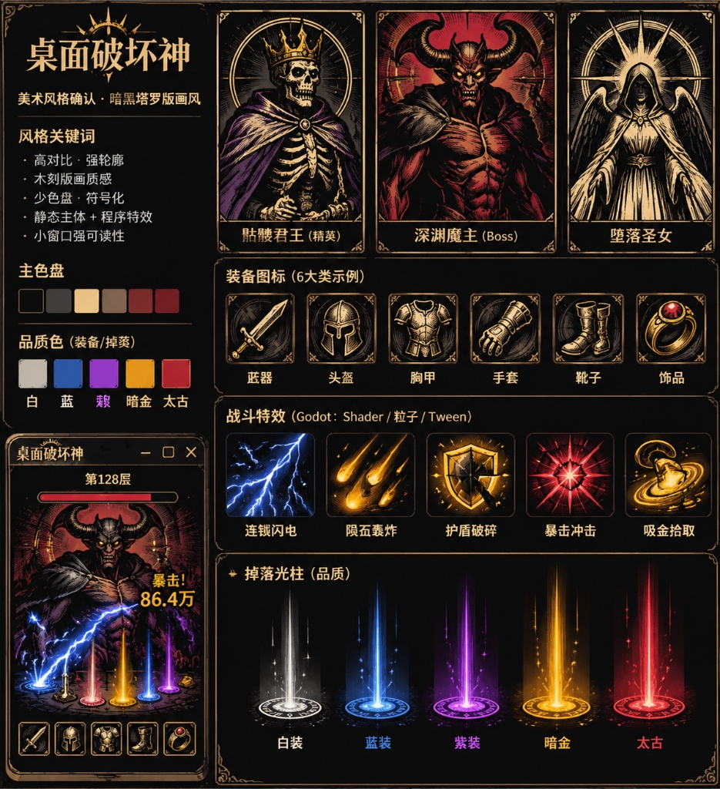
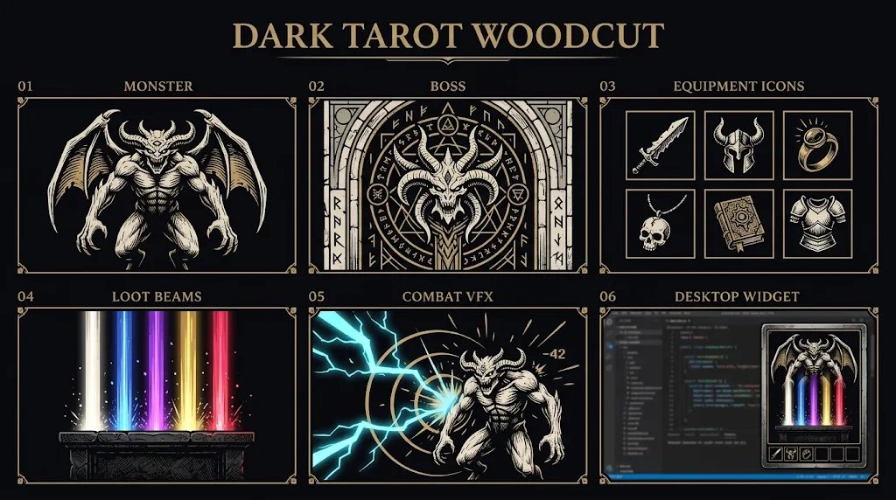
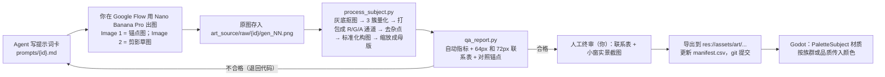

# 《桌面破坏神》美术风格圣经与 AI 资产生产规范 v1.0

> [!IMPORTANT]
> **已由 [art_pipeline_v1_1.md](04_美术资产管线_v1.1.md) 部分取代**：以下章节以 v1.1 为准——
> - §04.1 工具矩阵、§04.4 提示词：出图工具改为 GPT Image API；
> - §08 第 3–6 条：Pixel Composer、PixelFX、Megascans、Blender 的定位；
> - 主体颜色由 3 色改为 4 色，新增镀金通道；
> - 风格名称修订为「镀金债契 · 骨白版画」。
>
> 其余章节继续有效。
**Art Bible & AI Asset Production Spec · 依附于玩法框架 v6（玩法冻结，不受本文件影响）**

> 证据等级：**[C]** 已确认的事实或规范 · **[I]** 美术判断或推导 · **[待验证]** 工具能力或许可条款尚未在官方原文中核实，正式使用前必须核对。

---

## 00. 独立评审

### 00.1 对你提交的两张概念图的评审



| 问题 | 证据 | 结论 |
|---|---|---|
| 怪物是全彩厚涂，背景铺满红色和紫色，中间调过多 | 左下角 360×480 小窗里的魔主几乎糊成一团，只能靠那对角勉强认出来 | **这正是任务书禁止的“写实厚涂暗黑”**，在小窗里不可读 |
| 装备图标用了金属渐变和高光 | 头盔、胸甲、戒指都是“手游金属球面高光” | 违反“禁止手游式高光图标” |
| AI 生成了文字和 UI | 出现“藏器”（应为“武器”）、“陨丕轰炸”（应为“陨石轰炸”）等错字 | 再次证明：**AI 出图里绝不允许出现文字和 UI 结构** |
| 光柱排序、卡牌框结构、窗口布局 | 信息层级清楚 | ✅ 可以作为程序化 UI 的布局参考 |



| 问题 | 证据 | 结论 |
|---|---|---|
| 骨白配黑底、双色、强剪影 | 01 号怪物剪影在任何尺寸下都能认出来 | ✅ **最接近正确答案** |
| 排线密度接近铜版画 | 肌肉上的细排线缩到 72px 时会糊成灰色，并产生摩尔纹 | ❌ 必须改成**粗刀木刻**，不用铜版细线 |
| Boss 卡上的符文是 AI 伪文字 | 02 号拱门上的“符文” | ❌ 符文一律改由程序化 Shader 或自制字形生成 |
| 图标线宽不统一 | 戒指和书的线宽差约 2 倍 | ❌ 需要统一的线宽规范和后处理来约束 |

### 00.2 三个方向评分（每项 1–5 分，5 为最优）[I]

| 维度 | A 塔罗木刻 | B 风格化 2.5D | C 荧光刻线 | **A 主 + C 辅** |
|---|---|---|---|---|
| 1. 360×480 可读性 | 4（剪影强；细排线有风险） | 3（体积光影在小尺寸下变脏） | 5 | **5**（粗刀木刻 + 外轮廓光边） |
| 2. AI 批量出图的稳定性 | 4（双色约束本身会压住 AI 的漂移） | 2（AI 转 3D 结构不稳，需要手动建模） | 3（AI 做极简几何容易“各画各的”） | **5**（后处理量化 + Shader 着色可以强制统一） |
| 3. 单人开发成本 | 5 | 2（建模、材质、布光、渲染全链路） | 4 | **5** |
| 4. 怪物与装备的扩展性 | 5（神话题材取之不尽） | 3 | 2（几何怪物缺乏“刷怪”的奇幻感） | **5** |
| 5. 与战斗特效的融合 | 3（印刷品和发光特效天生冲突） | 4 | 5 | **5**（特效同样用“线条”语言） |
| 6. Steam 商店页吸引力 | 4 | 3（同质化最严重） | 3 | **5**（“黑底骨白版画 + 荧光刻线爆装”很少见） |
| 7. 资产统一与维护 | 4 | 2 | 4 | **5** |
| 8. 能否支撑数年扩展 | 5 | 3 | 3 | **5** |
| **合计** | 34 | 22 | 29 | **40** |

### 00.3 拍板理由

1. **不选 B**：3D 管线对单人开发来说成本最高，而且 AI 无法稳定产出 3D 资产。固定机位渲染出来的结果在小尺寸下，体积光影会变成灰色的脏点。风格化 2.5D 也是 Steam 上最泛滥的视觉语言，缺乏辨识度。
2. **不单选 C**：几何化的怪物撑不起“暗黑刷宝”的奇幻幻想，也撑不起收藏癖（稀有 Boss、图鉴）。长期内容扩展会显得空洞。
3. **选 A 为主体，但要做三处修正**：
   - **粗刀木刻，不用铜版细线**：解决缩小后变灰、出摩尔纹的问题。
   - **黑底骨白（反相印刷）**：主体在深色小窗里天然发亮。
   - **AI 只出灰度结构，颜色全部由 Godot Shader 赋予**：画风的统一不依赖 AI 每次都画对。
4. **C 只作为特效层**：所有发光特效也用“刻线”语言来画（折线、同心环、放射刀痕），不用柔光团。这样“印刷品主体”和“荧光特效”说的是同一种视觉语言。

---

## 01. 最终画风决策

| 项 | 冻结内容 |
|---|---|
| **风格名称** | **骨白版画 · 荧光刻线**（Bone Woodcut Tarot × Neon Etch） |
| **一句话定义** | 黑底上的骨白粗刀木刻塔罗主体，配以只用发光刻线绘制的品质与战斗特效。 |
| **主次比例** | 主体资产（怪物、Boss、装备）100% 用 A 骨白木刻；特效与提醒层 100% 用 C 荧光刻线；**B 为 0%** |
| **核心关键词** | 粗刀木刻 · 黑骨双色 · 一抹油墨色 · 正面塔罗站姿 · 强剪影 · 刻线发光 · 克制留黑 |
| **参考美术语言**（只作为内部参考，**严禁写进提示词**） | 丢勒木刻《启示录》系列的大块黑白；马赛塔罗的平涂色块与正面站姿；Mike Mignola 式的大面积黑块剪影；《暗黑地牢》的墨线克制；《邪恶冥刻》的牌桌仪式感 |
| **配色** | 墨黑、骨白，加一种“油墨色”点缀；高饱和色只属于特效（见 §03） |
| **轮廓** | 外轮廓必须闭合；外侧光边由 Shader 统一添加（骨白 40% 不透明度，显示尺寸下 1.5px） |
| **光影** | 固定左上 45° 主光。骨白表示受光面，黑色表示阴影；**禁止渐变，禁止柔光** |
| **材质** | 只通过刀痕方向区分：金属用平行横刀，布料沿褶皱走刀，皮肉用短弧刀，石材用交叉刀。**禁止反光高光** |
| **颗粒** | 只有窗口背景有 3% 纸纹噪点（程序化），主体资产里不画颗粒 |
| **细节密度** | 显示尺寸下，最细的线 ≥ 1.5px；主体内部的黑色面积占 35–55% |
| **可以融合** | 中世纪手抄本的边饰线条（只用于程序化卡框）、宗教图腾和光环（程序化 Shader）、蚀刻符号（自制字形） |
| **严格禁止** | 写实厚涂；3D 渲染质感；金属渐变高光；Midjourney 式暗黑海报光；赛博霓虹主体；像素风主体；动漫和手游角色比例；AI 伪文字；照片材质；柔光团粒子；镜头光晕和十字星芒 |

---

## 02. 视觉风格圣经

### 02.1 小窗布局与显示尺寸 [C：后续资产尺寸都以此为准]

```
360×480
 0– 24  标题栏（程序化）
24– 64  层数 / Boss 血条 / 机制图标
64–324  战场：主怪卡 176×220（左中）；排队卡 2 张，各 72×90（右侧，上下排列）
                Boss 出场时：Boss 卡 208×260 居中，排队卡隐藏
324–392 掉落地面（掉落图标 28×28，光柱从这里升起）
392–420 HUD：金币、净资产、负债、研究进度
420–476 6 个装备槽，每个 48×48，间距 8
```

### 02.2 怪物

| 规范 | 数值 |
|---|---|
| 生成画布 | 竖版 4:5（1024×1280 或更高） |
| 处理后母版 | 352×440，即主怪卡显示尺寸的 2 倍，兼顾 HiDPI；排队卡直接缩小使用，依靠 mipmap |
| 主体占比 | 主体高度占画布的 82–90%，水平居中偏差 ±4%，脚底落在 92% 高度线 |
| 视角 | 正面或正面偏 15° 的塔罗站姿，大体左右对称；镜头与主体等高 |
| 剪影规则 | 只能有 **1 个主导特征**（角、王冠、翅膀、獠牙，四选一）；四肢不得紧贴躯干；武器不得超出画布 |
| 细节密度 | 在 1024 画布上，刀痕线宽 ≥ 12px（换算到主怪卡显示尺寸约 2px）；排线只用在中间调区域 |
| 背景 | 生成时为纯平中灰 #808080，处理后为透明。卡底和光环由 Godot 绘制 |
| 描边 | 美术图本身自带墨黑外轮廓；外侧光边由 Shader 添加，**图里不画光边** |
| 颜色 | 墨黑、骨白，加 1 种族群油墨色，面积 ≤ 10% |
| 族群和油墨色 | 不死 = 旧金；恶魔 = 血墨；异兽 = 苔绿；堕圣 = 旧金；深渊教团 = 酒红（HEX 见 §03） |

### 02.3 Boss

| 与普通怪物的区别 | 规范 |
|---|---|
| 体型与构图 | 主体占画布高度 90–94%；镜头轻微仰视约 10°；肩宽 ≥ 画布宽度的 70% |
| 威压感 | 黑色面积提高到 50–60%；主导特征允许 2 个（例如王冠加翅膀）；油墨色面积可到 15% |
| 程序化加成 | 塔罗拱门卡框、背后旋转的符印环（Shader 生成）、登场时卡牌从上方落下并带震屏、血条加粗 |
| 稀有 Boss（第二阶段） | 卡框换成双线框，符印环改为对应品质色；不新增美术语言 |

### 02.4 装备

| 部位 | 视角与构图（统一左上主光） |
|---|---|
| 武器 | 从左下到右上 45° 斜放，主体覆盖对角线的 85% |
| 头盔 | 正面偏 3/4，面甲朝向左前方 |
| 胸甲 | 正面，肩线水平 |
| 手套 | 单只，3/4 视角，手指朝向右上 |
| 靴子 | 一双，左右前后错开，3/4 侧视 |
| 饰品 | 戒指或护符，俯视 3/4，宝石位于中心 |

> 6 个槽位的美术分类采用概念图里的“武器 / 头盔 / 胸甲 / 手套 / 靴子 / 饰品”。如果 v6 玩法文档另有定义，以玩法为准，只替换部位名称。

| 规范 | 数值 |
|---|---|
| 生成画布 | 1:1（1024²） |
| 处理后母版 | 96×96（槽位 48 的 2 倍）；运行时显示尺寸为 48、40、28 |
| 颜色 | 墨黑、骨白，加 1 种点缀色（宝石或镶嵌），面积 ≤ 8% |
| 金属 | **只用平行刀痕表现**，禁止任何高光和渐变 |
| **品质区分** | **图标本身不按品质换图**。品质完全由程序表现：<br>• 槽位框颜色<br>• 地面光柱<br>• 点缀色通道换成对应品质色<br>• 暗金：图标后加一层刻线光环<br>• 太古：光环加缓慢流动的刻线 Shader |
| 外观变体 | ① 白装、蓝装、紫装共用“底材图标”，每个部位 3 个底材；② 每件暗金有独立图标；③ 太古使用对应暗金的图标，加绯红点缀和流动 Shader；④ 幻化（第二阶段）只替换图标 ID，不新增画法 |

### 02.5 战斗特效（荧光刻线语言：一律用线、环、刀痕，不用柔光团）

| 特效 | 实现方式 | 视觉规格 | 时长 | 同屏上限 |
|---|---|---|---|---|
| 普通攻击 | Shader：受击闪白 + 卡牌轻微位移（Tween） | 主体整体变亮 60ms，向后位移 3px | 120ms | — |
| 暴击 | Shader：同心刻线环，带 8 道放射刀痕 | 白热核心 + 余烬色边 | 200ms | 3 |
| 连锁闪电 | `Line2D` 程序化折线，粗芯白、外侧闪电色，加法混合 | 每跳 3–5 个折点，线宽 3px | 每跳 90ms | 2 条链 |
| 陨石 | 拖尾 Sprite（程序化楔形）+ 落点冲击环 + 碎刻线 | 余烬色加骨白 | 600ms | 1 |
| 护盾破碎 | Shader：Voronoi 碎片沿法线飞散 | 钢蓝玻璃色，碎片带骨白边 | 350ms | 1 |
| 落地即爆 | Shader：品质色扩张环 + 4–6 道楔形刀痕 | 环半径 ≤ 40px | 250ms | 由 VfxBudget 合并 |
| 暗金喷泉 | 已有的自写弹道 + 光柱 Shader + 地面符印环 | 暗金色光柱高 160px | 2.5s | — |
| 自动熔炼 | Shader：图标由下往上溶解成余烬线，飞向熔炉图标 | 余烬色细线 | 400ms | 合并 |
| 金币吸附 | `GPUParticles2D`：短线状金屑沿曲线飞向 HUD | 金币色，粒子长 4–6px | 500ms | 64 颗 |

**特效规则**：
- 主怪卡中心 40% 区域（即脸和躯干）被遮挡的面积，在任意 200ms 窗口内不得超过 30%。
- 伤害数字只出现在战场上部的 1/3。

### 02.6 桌面窗口

- **背景**：#0E0F14，不透明度 0.85，3% 纸纹噪点，圆角 12，1px 描边 #FFFFFF14（沿用架构文档 §3.3）。
- **信息层级**：
  - L1 主怪与血条
  - L2 光柱与掉落
  - L3 伤害数字
  - L4 HUD
  - L5 边缘提醒光带
  
  层级越低，饱和度和亮度越低。
- **视觉密度**：常态下同屏饱和色相 ≤ 3 种；喷泉或 Boss 死亡时允许到 5 种，但最多持续 2 秒。
- **特效预算**：沿用 VfxBudget 的设定（每帧 24 个实例、6 个音效）。
- **品质提醒**：

| 品质 | 光柱 | 其他提醒 |
|---|---|---|
| 白 | 无光柱，直接熔炼 | — |
| 蓝 | 细光柱 0.6s | — |
| 紫 | 光柱 1.0s | — |
| 暗金 | 高光柱 + 地面符印环 | 专属音效 + 窗口边缘暗金光带 |
| 太古 | 绯红光柱 | 边缘脉冲 + 120ms 慢动作 |

---

## 03. 色彩系统（HEX 冻结）[C]

| 类别 | 名称 | HEX | 用途与限制 |
|---|---|---|---|
| 背景 | 窗底 | `#0E0F14` | 窗口背景 |
| | 卡底 | `#16161C` | 怪物卡、装备槽的底色 |
| | 墨黑 | `#0B0A0C` | 主体阴影和轮廓 |
| 灰阶 | 铁灰 | `#3A3A42` | 未激活的 UI |
| | 灰烬 | `#6E6A66` | 次要文字 |
| 骨白 | 骨白 | `#E8DCC0` | 主体受光面、主文字 |
| | 骨影 | `#B8A888` | 只用于 UI 次级描边 |
| 旧金 | 旧金 | `#B08D57` | 卡框、不死族和堕圣族的油墨色 |
| | 旧金亮 | `#D9B26F` | 卡框高亮 |
| 品质（只用于特效、边框、点缀通道） | 白装 | `#E6E6E6` | |
| | 蓝装 | `#4C8DFF` | |
| | 紫装 | `#B45CFF` | |
| | 暗金 | `#FF9F1A` | 饱和橙金，**与旧金、金币刻意拉开差距** |
| | 太古 | `#FF2E4D` | **全游戏唯一允许发光的红色** |
| 特效 | 闪电 | `#9FE8FF`，核心 `#FFFFFF` | 加法混合 |
| | 暴击 | `#FFF4D6`，边缘 `#FF5A1F` | 以白热色为主 |
| | 金币 | `#E9C46A` | 只用于小颗粒 |
| | 护盾 | `#A8C8E8` | |
| | 毒素 | 主体油墨 `#4E7A3A`，特效 `#8CFF5A` | |
| 血与诅咒（**禁止发光**） | 血墨 | `#7A0F14` | 恶魔族油墨色、血液特效，只用正常混合 |
| | 诅咒 | `#2A1033` 烟色，配骨白符线 | 正常混合 |
| | 酒红 | `#6A1B3A` | 深渊教团族油墨色 |
| 伤害数字 | 普通 | `#E8DCC0` | |
| | 暴击 | `#FFF4D6`，带 `#FF5A1F` 描边 | |

**色彩规则**：
1. **颜色数量上限**：怪物、Boss、装备主体都是 3 色（墨黑、骨白、1 种油墨或点缀色，不含抗锯齿过渡）；每种特效 1 个色相，按核心白 → 色相 → 暗色相淡出做 3 段渐变；窗口 UI 只用灰阶、骨白和旧金。
2. **主体和特效分离**：主体只能使用**低饱和的油墨色**；**高饱和、发光的颜色只属于品质色、闪电、暴击和金币**。同一种颜色族在主体里一律用油墨版本。
3. **防止颜色污染**：
   - 加法混合的特效不得叠加在同色的品质光柱上。
   - 血和诅咒永远不发光，避免和太古红混淆。
   - 暗金、旧金、金币在饱和度和明度上分属三档。
4. **小尺寸识别**：在 28px 的掉落图标上，品质只靠光柱和底环颜色识别，不靠图标本身；**灰度测试**（把截图转成黑白）下，五档品质的光柱亮度必须依次递增。

---

## 04. AI 资产生产管线

### 04.1 工具职责矩阵（冻结）

| 资产 | 工具 | 理由 |
|---|---|---|
| 怪物、Boss、装备图标、特殊暗金、收藏品 | **Nano Banana Pro（Google Flow）** 只负责出灰度结构 | 唯一的 AI 出图工具 |
| 去背、量化、通道打包、裁切、QA | **Python 脚本** `tools/art/`（Pillow + numpy） | Agent 可以直接执行，结果可复现，可以批量跑 |
| 着色、受击、溶解、外侧光边、品质点缀、族群变色 | **Godot Shader** `palette_subject.gdshader` | 颜色在运行时统一赋予，**画风锁死在引擎里** |
| 光柱、符印环、暴击环、落地爆炸、护盾碎裂、熔炼溶解 | **Godot Shader** | |
| 闪电 | **`Line2D` 程序化** | |
| 金币、余烬、喷泉 | **`GPUParticles2D` 和已有的自写弹道** | |
| 所有窗口、按钮、血条、卡框、槽位、提示框 | **Godot 原生 UI**（StyleBoxFlat、`_draw`） | 任务书的硬约束 |
| 符文、符印 | **自制字形或程序化几何** | 禁止使用 AI 伪文字 |
| 字体 | 思源宋体 / Noto Serif SC（SIL OFL 许可） | 契合刻字气质；OFL 允许商用嵌入 [C] |
| 爆炸序列、冲击序列的**灰度遮罩**（可选） | **PixelFX**，只导出灰度帧，再经过渐变映射 | 见 §08 |
| Pixel Composer / Blender / Megascans | **v1 不进入管线** | 见 §08 |

### 04.2 生产流程



### 04.3 关键技术：灰度通道打包与运行时着色 [C]

处理后的 PNG 不存颜色，只存三个通道：

| 通道 | 内容 |
|---|---|
| R | 骨白含量（0 = 墨黑，1 = 骨白） |
| G | 点缀遮罩 |
| A | 透明度 |

两个通道分开存储，抗锯齿边缘插值时就不会在黑白交界处混出点缀色杂边。

```glsl
// res://assets/shaders/palette_subject.gdshader
shader_type canvas_item;
uniform vec4 ink : source_color = vec4(0.043, 0.039, 0.047, 1.0);   // #0B0A0C
uniform vec4 bone : source_color = vec4(0.91, 0.863, 0.753, 1.0);    // #E8DCC0
uniform vec4 accent : source_color = vec4(0.69, 0.553, 0.341, 1.0);  // 族群油墨色或品质色
uniform float flash = 0.0;          // 受击闪白
uniform float dissolve = 0.0;       // 死亡或熔炼溶解
uniform sampler2D noise_tex;
void fragment() {
    vec4 t = texture(TEXTURE, UV);
    vec3 c = mix(ink.rgb, bone.rgb, t.r);
    c = mix(c, accent.rgb, t.g);
    c = mix(c, vec3(1.0), flash);
    float a = t.a * step(dissolve, texture(noise_tex, UV).r);
    COLOR = vec4(c, a);
}
```

外侧光边用一个单独的 outline pass（采样 alpha 邻域，颜色为骨白，不透明度 0.4）。

**收益**：
- 1 张怪物图，就能派生出精英、族群、机制区间、受击、死亡等全部外观。
- 换一套色盘只需要改参数，不需要重画。
- AI 出图时的色偏会在量化这一步被全部抹掉。

**Godot 导入设置**：压缩选 Lossless；开启 Mipmaps；Filter 用 Linear；关闭 sRGB 转换的 Detect 选项，按数据纹理处理，具体导入项以你使用的版本为准 **[待验证]**。

### 04.4 提示词模板（Nano Banana Pro · Google Flow）

> 规则：比例放在开头，用自然语言描述；附件按 Image N 引用；**不写任何 MJ 参数，不写画师名**。Flow 无法锁定种子，所以一致性靠三件事保证：锚点参考图、剪影草图、后处理量化。

**怪物模板**
```
Vertical 4:5 portrait format. Use Image 1 strictly as the style reference: match its bold hand-carved woodcut line weight, its two-tone ink-black and bone-white look, and its graphic simplicity. Use Image 2 only for the pose and outer silhouette.
Depict a single {creature}, front-facing in a symmetrical, iconic tarot-card standing pose, full body visible from head to feet, centered, filling about 86% of the frame height.
Render it as a coarse relief woodcut print: large solid black shadow shapes, thick confident gouge strokes, coarse parallel hatching only in the mid-tones, lit surfaces in flat warm bone white, and one small accent of muted {accent ink} limited to {accent location}. One dominant silhouette feature only: {horns | crown | wings | tusks}. Light comes from the upper left.
The background is a completely flat, uniform medium gray with nothing else in it.
Avoid: fine engraving lines, gradients, soft painterly shading, glow, metallic shine, photorealism, 3D render look, frames, borders, ground, text, letters, runes, symbols.
```

**Boss 增补句**（插在 Render 句之前）
```
Make it a towering boss: seen from a slightly low camera angle, shoulders spanning most of the frame width, filling about 92% of the frame height, heavier black masses, with {two dominant features}.
```

**装备图标模板**
```
Square 1:1 format. Use Image 1 strictly as the style reference for line weight, two-tone ink-black and bone-white palette, and carving texture.
A single {item}, {view rule from Art Bible 02.4}, centered, occupying about 80% of the frame.
Render it as a coarse woodcut print icon: a thick closed black outer contour, flat bone-white lit surfaces, solid black shadow shapes, coarse hatching for mid-tones. Metal is shown only by parallel carved hatching bands. Only the {gem | inlay} carries a small muted accent. Light from the upper left.
Flat uniform medium gray background with nothing else.
Avoid: shiny reflections, gradients, glow, sparkles, frames, text, letters.
```

**参考图控制**：
- Image 1：永远是冻结的锚点图（`art_source/anchors/`），对应怪物、Boss 或图标的类别。
- Image 2：剪影草图。可以手绘的黑色剪影，也可以是第二阶段的 Blender 白模截图。
- 最多再加一张 Image 3，作为同族群已通过的资产。

### 04.5 后处理脚本规格（`tools/art/process_subject.py`，第一次生产前由 Agent 编写）

1. 读入原图，对图像做 k-means 聚类，分成 4 簇：灰底、墨黑、骨白、点缀。灰底簇再加上从画布边缘出发的 flood fill 连通判定，作为透明区域。
2. 把非透明区域里的墨黑、骨白、点缀分别映射到 R 和 G 通道；alpha 边缘做 1px 羽化。
3. 删除面积小于 0.05% 画布的连通杂点。
4. 按主体包围盒裁切，再放到标准画布上：主体高度 86%（Boss 92%），脚底对齐 92% 高度线。
5. 用 area 滤波缩放到母版尺寸（352×440 / 416×520 / 96×96）。
6. 输出 PNG，并把原图哈希和参数写入 `manifest.csv`。

### 04.6 文件命名、目录与版本

```
F:\挂机游戏制作\
├─ art_source\            # 放 .gdignore，不让 Godot 导入
│  ├─ anchors\            # anchor_monster_v1.png 等，冻结后只读
│  ├─ prompts\{asset_id}.md
│  ├─ raw\{asset_id}\gen_01.png …
│  ├─ rejected\{asset_id}\gen_03_R-LINE.png
│  └─ manifest.csv        # asset_id, version, prompt_file, refs, raw_hash, qa_scores, status, reviewer, date
├─ tools\art\process_subject.py  qa_report.py  contact_sheet.py
└─ assets\art\            # 即 res://assets/art/
   ├─ monsters\mon_{family}_{name}_v{NN}.png      # 例：mon_undead_skeleton-king_v01.png
   ├─ bosses\boss_{name}_v{NN}.png
   ├─ items\eq_{slot}_{base|uniq}_{name}_v{NN}.png  # slot = weapon/helm/chest/gloves/boots/trinket
   ├─ vfx\vfx_{name}_{frames}f_{w}x{h}.png
   └─ shaders\
```

- **版本管理**：用 git；`art_source/raw/**/*.png` 走 Git LFS。资产修订时 `vNN` 递增，旧版本不删除。规范冻结时打 tag `art-bible-v1.0`。
- **Steam 合规**：使用了 AI 预生成内容，上架时**必须**在 Steam 内容调查问卷中如实披露 [C：Steam 自 2024 年起要求披露]。`manifest.csv` 就是披露依据。

---

## 05. Agent 美术执行规则（可整段复制给任何 Agent）

```
【《桌面破坏神》美术执行规则 · Art Bible v1.0 · 不可更改】

你在为《桌面破坏神》生产或处理美术资产。画风已冻结为「骨白版画 · 荧光刻线」。
开工前，先读 art_source/anchors/ 下的全部锚点图和 Art Bible §02–§03。

一、必须遵守
1. 只生产 Art Bible 列出的资产类型：怪物、Boss、装备图标、特殊暗金、收藏品主体。UI、文字、边框、背景一律不做。
2. 出图工具只有 Google Flow 里的 Nano Banana Pro。提示词只能从 §04.4 模板出发，填写 {} 字段。比例用自然语言写在开头；禁止任何 Midjourney 参数；禁止写画师名。
3. 每次出图，Image 1 必须是对应类别的锚点图；Image 2 是剪影草图。
4. 原图必须经过 tools/art/process_subject.py 处理，并通过 qa_report.py。没有通过的图禁止放进 res://assets。
5. 颜色只能由 Godot 的 palette_subject Shader 赋予。图里只能有墨黑、骨白、一种点缀，背景必须是纯灰。
6. 严格按 §04.6 命名和存放文件，并更新 manifest.csv。

二、可以自主决定
- 怪物的具体造型和神话母题（必须属于既有族群）、主导特征是哪一种、刀痕的走向。
- 装备的具体形制，例如剑刃形状、头盔样式，在部位视角规则以内。
- 特效的具体时长和粒子数，在 §02.5 给出的范围和上限以内。
- 同一资产最多重生成 3 次；挑选最佳结果。

三、绝对不能擅自改变
- 色盘的 HEX 值、颜色数量上限、"高饱和只属于特效"这条规则。
- 线宽下限、黑色面积比例、主体占比、视角和主光方向。
- 给主体加渐变、柔光、金属高光、发光、照片材质、3D 渲染质感。
- 在任何图里出现文字、字母、符文、边框或 UI 结构。
- 引入新的美术工具、新的风格参考，或修改锚点图。
- 如果认为规范需要修改：停止工作，写一份变更提案提交给项目负责人，不得自行执行。

四、跑偏判定（满足任意一条即为不合格）
R-PAL   量化前，有超过 3% 的像素与三个色心的色差 ΔE > 12；或出现第 4 种颜色
R-LINE  显示尺寸下，宽度小于 1.5px 的墨线占比超过 15%（铜版化、细线化）
R-SIL   黑色剪影缩到 48px（怪物）或 32px（图标）后，无法在 1 秒内认出它是什么
R-MASS  主体内部的黑色面积超出范围：怪物 35–55%，Boss 50–60%
R-COMP  主体占比、居中或脚线不符合 §02.2–02.4
R-AIERR 结构错误：肢体或手指数量不对、部件融化、不对称的畸形、武器断裂
R-TEXT  出现任何类似文字的笔画
R-STYLE 与锚点图并排对比时，线宽、刀痕或体量感明显不一致（评审打分 < 4/5）

五、退回流程
不合格的原图移到 art_source/rejected/{asset_id}/，文件名后缀加上退回代码。
在提示词卡里记录失败原因和修改后的提示词，然后重新生成。
同一资产连续 3 次不合格：停止，并向项目负责人报告。

六、防止画风分裂
- 所有 Agent 共用同一组锚点图、同一个脚本、同一个 Shader。画风由流程锁定，不由个人理解决定。
- 每批交付都要附上 qa_report 生成的联系表：新资产与锚点图并排，分别缩放到 64px 和 72px。
- 新族群或新部位第一次出图时，先只做 1 张，由项目负责人批准后才能批量生产。
```

---

## 06. D2–D3 最小资产清单

| 类别 | 数量 | 内容 | 说明 |
|---|---|---|---|
| **锚点包（第 0 步，必须最先做）** | 4 | 1 个怪物、1 个 Boss、2 个图标（武器、头盔） | 你批准后冻结，成为所有后续资产的 Image 1 |
| 怪物 | **3** | 骷髅（不死，旧金）、小恶魔（恶魔，血墨）、腐兽（异兽，苔绿） | 通过 Shader 变色加缩放，可以得到 9 种外观；排队卡共用这些图 |
| Boss | **1** | 深渊魔主（恶魔，双特征：角加王冠） | 护盾区间的变体用 Shader 着色，不重画 |
| 装备图标 | **6** | 每个部位 1 个底材 | 五档品质都由程序表现；暗金的独立图标 D4 再做（对应 3 条特效词条） |
| 特效（全部程序化） | 0 张图 | 光柱、地面符印环、受击闪白、溶解死亡、暴击环、熔炼溶解加余烬线、金币粒子与吸附、伤害数字、边缘提醒光带 | 喷泉弹道已有 |
| 直接用几何图形替代 | — | 金币（圆形加内环）、余烬（短线）、熔炉图标（矢量）、血条、卡框、光环、机制图标 | 正式版也可以继续沿用 |
| **放到第二阶段** | — | 连锁闪电、落地爆炸、杀戮狂热（这三项在 D4 做）；护盾碎裂（D5）；陨石；暗金和太古的独立图标；稀有 Boss；套装；图鉴插画；外观与幻化；Steam 主视觉；PixelFX 序列 | |

**D2–D3 共需 AI 出图 14 张**（锚点包 4 张 + 10 张正式资产）。按每张平均重生成 3 次估算，约 40 次出图。

---

## 07. 最终风格验收标准

| # | 检查项 | 方法 | 通过 | 不通过 |
|---|---|---|---|---|
| V1 | 小尺寸轮廓 | 图标缩到 64 和 32px、怪物缩到 72×90，做成剪影联系表 | 1 秒内能说出部位或族群 | 犹豫或认错 |
| V2 | 色盘 | `qa_report` 统计色心偏差 | 偏差像素 ≤ 3%，处理后严格 3 色 | 超出 |
| V3 | 线宽 | 距离变换，统计显示尺寸下的线宽 | 小于 1.5px 的墨线 ≤ 15% | 超出 |
| V4 | 黑色面积 | 主体内部的墨黑占比 | 怪物 35–55%，Boss 50–60%，图标 30–50% | 超出 |
| V5 | 构图 | 包围盒统计 | 占比、居中、脚线都在 §02 规定的公差内 | 超出 |
| V6 | AI 结构错误 | 人工检查清单 | 0 项 | ≥ 1 项 |
| V7 | 伪文字 | 人工检查 | 0 处 | ≥ 1 处 |
| V8 | 风格冲突 | 与锚点并排，从线宽、刀痕、体量、剪影 4 项打分 | 每项 ≥ 4/5 | 任意一项 < 4 |
| V9 | 小窗实景 | 360×480 窗口截图：主怪 + 5 档品质光柱 + 暴击 + 伤害数字 | 主怪始终可辨；灰度截图里品质亮度依次递增 | 主体被特效淹没，或品质无法区分 |
| V10 | 特效抢占 | 录屏 10 秒，逐帧统计 | 中心 40% 区域在任意 200ms 内的遮挡 ≤ 30% | 超出 |
| V11 | 独立游戏品质（只评锚点包） | 你主观判断：这张图敢不敢放在 Steam 胶囊图上 | 敢 | 不敢 → 重做锚点，不往下生产 |

---

## 08. 最终冻结建议

| # | 问题 | 拍板 |
|---|---|---|
| 1 | 最终画风 | **骨白版画 · 荧光刻线**：A 粗刀木刻主体 + C 刻线特效，B 为 0% |
| 2 | 2D 与 3D 的比例 | **100 : 0**。Blender 不产出任何最终资产 |
| 3 | Pixel Composer 是否作为核心工具 | **否**。它以像素工作流为核心，与本画风的主体不匹配；它有 headless 命令行（`PXC.exe -h`），售价约 \$15 **[待验证：以官网和商店页为准]**，但 Python 脚本更容易让 Agent 维护和复现。只保留为“第二阶段可选的特效序列试验台” |
| 4 | PixelFX 的职责 | **只作为可选的灰度遮罩来源**：爆炸、冲击的帧序列，只导出明度，再用 Godot 渐变映射套项目色盘，放大时用线性过滤消除像素感。它是 MIT 许可的代码库，可以导出 PNG 加 JSON 序列 **[待验证：仓库 LICENSE 原文、内置资源是否另有许可；发行时附带 MIT 声明]**。**禁止直接使用它的默认色彩和像素外观** |
| 5 | Megascans 是否加入 | **否**。照片材质与木刻语言根本冲突，经过版画化处理后的收益低于直接让 AI 出木刻。许可方面，Fab 标准许可通常允许用于其他引擎的商业游戏，但禁止二次分发原始素材，网传“永久免费”**[待验证：以 Fab 授权页原文为准]**。即使许可完全没问题，也不采用 |
| 6 | 是否需要 Blender | **v1 不需要**。第二阶段只允许一种用途：白模摆姿势，截图作为 Image 2 剪影参考 |
| 7 | D2–D3 先做什么 | ① 锚点包 4 张，由你批准并冻结 → ② 编写 `process_subject.py`、`qa_report.py`、`palette_subject.gdshader` → ③ 3 个怪物 + 1 个 Boss + 6 个图标 → ④ 程序化特效 |
| 8 | 现在就冻结的决定 | 风格名称与定义；§03 全部 HEX 值；颜色数量上限；“高饱和只属于特效”；灰度通道打包加 Shader 着色的管线；线宽、黑色面积、构图公差；小窗布局尺寸；工具矩阵（AI 只用 Nano Banana Pro）；命名与目录；Agent 规则 §05；验收表 §07 |
| — | 唯一保留到锚点阶段再定的 | 锚点图的具体造型。必须先过 V11，之后才能视为 v1.0 正式生效 |
