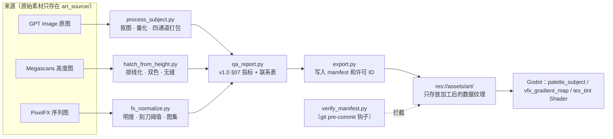

# 《桌面破坏神》低成本美术资产生产管线 v1.1
**本文件取代《美术风格圣经 v1.0》中的以下章节：§04.1 工具矩阵、§04.4 提示词、§08 第 3–6 条。新增：财富主题的风格修订。v1.0 的其余规范继续有效。**

> 证据等级：**[C]** 已经在官方原文或仓库原文中核对 · **[I]** 推导或估算 · **[待验证]** 正式投入使用前必须核对原文。
>
> 本项目的硬性要求优先于全局默认设置：**主体出图改用 OpenAI GPT Image API**，Google Flow / Nano Banana Pro 不再是主力工具。提示词仍然遵守全局规则：用自然语言描述比例，不写任何 Midjourney 参数。

---

## 0. 已核实的事实（2026-11-12 抓取）

| 资源 | 核实内容 | 等级 |
|---|---|---|
| **GPT Image API** | 官方价格页列出 `gpt-image-2.6-sunburst` 和 `gpt-image-2.6-flare`：图像输入 \$8 / 百万 token，图像输出 \$30 / 百万 token，文本输入 \$5 / 百万 token（缓存后 \$1.25）。Batch 栏列出 `gpt-image-2`：输出 \$15 / 百万 token。图像生成指南建议：草稿用 `quality: low`；Sunburst 适合精确编辑，Flare 适合日常生成；支持 png/webp/jpeg 输出，也支持 SVG 输出 | [C] |
| GPT Image 单张图消耗多少 token | 官方指南只提供计算器，没有给出固定数字 | **[待验证]**：首次调用时从返回的 `usage` 字段实测 |
| GPT Image 透明背景、竖版尺寸、多张参考图输入 | 本次抓取没有找到原文 | **[待验证]**。本管线不依赖这几项：仍然用灰底出图，由脚本抠图 |
| GPT Image 输出物的权属 | 一般理解是 OpenAI 条款把输出物的权利归属给用户 | **[待验证]**：以当时生效的 OpenAI 服务条款为准，并存档条款快照 |
| **PixelFX** `LICENSE` | MIT，Copyright (c) 2026 Patch / Hugo Duprez | [C] |
| PixelFX `NOTICE.md` | ① `src/core/sim.js` 及文件头注明的效果改编自 Sprite Fusion（Hugo Duprez，MIT）；② `src/core/act.js` 改编自 Hollow Crown（rehan-remade，MIT）；③ **`gallery/fonts` 下的 Patch Pixel 字体“保留所有权利”，不属于 MIT 许可** | [C] |
| PixelFX 导出方式 | `node tools/render.mjs <分类>/<效果> --sheet`（可加 `--no-actor` 去掉演示角色）→ 输出 PNG 加 Aseprite 风格的 JSON | [I]：来自搜索摘要，**首次使用时以 README 原文为准** |
| **Megascans / Fab** | 适用 Fab Standard License；可以在 Unreal 以外的引擎里使用；禁止二次分发原始素材；网传“整个库永久免费” | **[待验证]**：来自搜索摘要。**必须逐项核对单个资产页面标注的许可**，并截图存档 |
| **Pixel Composer** | 正式版约 \$15，有 headless 命令行（`PXC.exe -h`）；Demo 版本较旧 | **[待验证]**。另外，Demo 产出能否商用尚未确认，在确认之前只作评估用 |

---

## 1. 风格修订：加入财富主题，建立自己的画风

**风格名称修订为：「镀金债契 · 骨白版画」（Gilded Debt Woodcut）**，特效层仍是荧光刻线。

一句话定义：**黑底骨白的粗刀木刻怪物，身上带着镀金的财富腐化物——钱币、锁链、契约、天平；镀金的亮度会随玩家的财富状态实时变化。**

### 1.1 财富母题系统（每个怪物和 Boss 必须带 1 个）

| 族群 | 财富母题 | 族群油墨色 |
|---|---|---|
| 守财亡骸（不死） | 眼窝里嵌着金币、肋骨缠着钱袋 | 旧金 |
| 债魔（恶魔） | 契约卷轴、身上缠着带锁的债链 | 血墨 |
| 吞金兽（异兽） | 腹部裂口露出金币、獠牙是金条 | 苔绿 |
| 镀金圣像（堕圣） | 半身镀金剥落、手持天平 | 旧金 |
| 典当教团（深渊） | 当票、铸币印模、蒙面账簿 | 酒红 |

### 1.2 新增“镀金通道”（修订 v1.0 的 §03 和 §04.3）

主体资产改为 **4 通道打包**：

| 通道 | 内容 | 面积上限 |
|---|---|---|
| R | 骨白含量 | — |
| G | 族群油墨色 | ≤ 6% |
| B | **镀金遮罩** | ≤ 12% |
| A | 透明度 | — |

主体的颜色上限由 3 色改为 **4 色**：墨黑、骨白、镀金、族群油墨色。

镀金色值固定为 `#C9A04E`（亮部 `#E9C46A`）。它和品质色“暗金” `#FF9F1A` 的饱和度明显不同，不会混淆。

### 1.3 财富压力可视化（只改表现层，不改 v6 玩法）

Shader 读取 Sim 输出的财富压力 Δh_wealth，并据此改变怪物的镀金层：

- **Δh_wealth > 0**（囤钱）：镀金层变亮，并出现缓慢流动的刻线光泽。怪物看起来被你的金币养肥了。
- **Δh_wealth = 0**：镀金层保持常态。
- **负债**：镀金层按噪声逐步剥落（只对 B 通道做 dissolve），露出底下的骨白。

**结果：玩家不用看数字，瞥一眼小窗就知道自己现在“太富”还是“在负债”**。这正是 v6 核心机制的视觉表达，而且实现成本为零。

---

## 2. 工具与来源总表（冻结）

| 来源 | 承担的职责 | 金钱成本 | 不承担的职责 |
|---|---|---|---|
| **GPT Image API** | 所有原创主体：怪物、Boss、装备图标、特殊暗金、财富道具、收藏品、Steam 主视觉（第二阶段） | 按 token 计费，见 §4 | 特效、UI、纹理 |
| **PixelFX**（MIT） | 爆炸、冲击、烟雾消散、诅咒、毒云、金币爆散等**灰度动画遮罩** | \$0 | 不使用它的默认配色和像素外观；**不使用 Patch Pixel 字体** |
| **Megascans**（逐项核对许可） | 只用表面材质（石材、混凝土、金属）的高度图，转换成木刻排线的平铺纹理 | \$0（以资产页面为准） | 不使用 3D 模型；不直接使用照片色彩 |
| **Pixel Composer Demo** | **只做评估**（§6），默认不进入管线 | \$0 | 在许可确认前，不产出任何最终资产 |
| **Python** | 唯一的统一加工站：抠图、量化、通道打包、排线化、渐变映射、质检、许可校验 | \$0 | — |
| **Godot Shader / 粒子 / `Line2D`** | 着色、受击、溶解、镀金状态、光柱、符印环、闪电、护盾碎裂、喷泉、金币吸附 | \$0 | — |
| **Godot 原生 UI** | 全部 UI | \$0 | — |
| **Noto Serif SC**（SIL OFL） | 字体 | \$0 | — |
| Blender | **v1.1 不使用** | — | — |

**Python 依赖**（都是免费开源）：Pillow、numpy、scikit-image（BSD）、opencv-python-headless（Apache-2.0）、openai SDK。另需 Node.js（运行 PixelFX 导出）。各依赖的版本和许可证在首次安装时写入 `LICENSES.csv`。

---

## 3. 逐项资产规格（来源 · 成本 · 加工 · 格式 · 许可记录）

> 成本按“每张通过验收的资产”估算，假设单张输出 token 数接近上一代模型的量级：low 约 300、medium 约 1,100–1,600、high 约 4,000–6,000，单价 \$30 / 百万 token **[I，以首次调用的实测 `usage` 为准]**。

| # | 资产 | 来源 | 单件成本估算 | 加工步骤 | 最终格式 | 许可记录 |
|---|---|---|---|---|---|---|
| 1 | 普通怪物 | GPT Image：4 张 low 草稿 → 选 1 张 → 1–2 次 medium 定稿编辑 | **约 \$0.05–0.10** | `process_subject`：灰底抠图 → 4 簇量化 → RGBA 四通道打包 → 去杂点 → 构图标准化 → 缩放到 352×440 | PNG，四通道打包数据纹理；运行时用 `palette_subject` 着色 | `openai` 类型：模型、日期、request id、提示词哈希、usage、费用、条款快照编号 |
| 2 | Boss | 同上，定稿用 medium，锚点用 high | 约 \$0.10–0.40 | 同上，416×520 | 同上 | 同上 |
| 3 | 装备底材图标（每部位 3 个） | GPT Image，正方形 | 约 \$0.04–0.08 | 同上，96×96 | 同上，品质色走 G 通道 | 同上 |
| 4 | 特殊暗金、太古、收藏品图标 | GPT Image | 约 \$0.04–0.08 | 同上 | 同上 | 同上 |
| 5 | 财富道具（金币堆、宝箱、账簿、契约、天平） | GPT Image | 约 \$0.04–0.08 | 同上 | 同上；用于信贷面板、回归报告等插图位 | 同上 |
| 6 | 木刻平铺纹理：地面条、卡底暗纹、Boss 拱门填充、窗口纸纹 | Megascans 表面材质的**高度图** | \$0 | `hatch_from_height`：高度图 → 归一化 → 沿光照方向生成等距排线（线宽 = f(高度)）→ 阈值化为双色 → 无缝化处理 → 256² | PNG 单通道（R），运行时着色；不透明度 ≤ 15% | `megascans` 类型：资产页 URL、资产 ID、页面所示许可名称、领取日期、Epic 账号、**许可区域截图路径**、“禁止二次分发原始素材”标记 |
| 7 | 特效序列：爆炸、冲击、消散、诅咒、毒云、金币爆散 | PixelFX，`render --sheet --no-actor` | \$0 | `fx_normalize`：<br>• 只取明度<br>• 4× 放大后重新阈值化成 3 级（得到刻刀质感、去掉像素阶梯）<br>• 统一帧尺寸和帧率<br>• 重新打包成图集 | 灰度 PNG 图集 + JSON；运行时用 `vfx_gradient_map` 按 §03 的色带着色 | `pixelfx` 类型：仓库 commit 哈希、效果路径、该文件头的署名（Sprite Fusion / Hollow Crown）；把 MIT 全文写入 `third_party_notices.txt` |
| 8 | 光柱、符印环、暴击环、落地爆炸、护盾碎裂、熔炼溶解、闪电、喷泉、金币吸附 | Godot Shader / `Line2D` / 粒子 | \$0 | — | `.gdshader` / `.tscn` | `procedural`：原创，无需许可 |
| 9 | 溶解噪声 | Godot `NoiseTexture2D` | \$0 | — | 引擎内资源 | `procedural` |
| 10 | 符文、符印字形 | 手写 SVG 几何图形（Agent 用代码生成） | \$0 | 导入为 Godot 的 SVG 纹理，或 `_draw` 路径 | SVG | `procedural` |
| 11 | UI 全套 | Godot 原生 | \$0 | — | `.tres` / `.tscn` | `procedural` |
| 12 | 字体 | Noto Serif SC | \$0 | 子集化（只保留游戏中用到的字） | OTF / WOFF2 | `font`：OFL 全文和版权行写入 `third_party_notices.txt` |
| 13 | Steam 胶囊图、主视觉（第二阶段） | GPT Image high，加手工构图 | 约 \$1–3 | 用同一套处理流程，允许更高的细节密度 | PNG | `openai` 类型；同时作为 Steam AI 内容披露的依据 |

**D2–D3 预算**：锚点 4 张 + 正式资产 10 张。
- 草稿：14 × 4 × low ≈ \$0.5
- 定稿：14 × 1.5 × medium ≈ \$1–2
- 锚点：4 × 2 × high ≈ \$1–2

**合计约 \$3–5 [I]**。长期每新增 100 件主体资产，约 \$6–12。

---

## 4. GPT Image 成本控制：把钱花在结构上，不花在颜色上

1. **颜色问题永远不靠重新生成解决**：量化和 Shader 会抹掉所有色偏。只有**结构、剪影、构图**不合格时才允许重新出图。
2. **两段式出图**：
   - 第一段：low 质量，`n=4`，用来挑构图（约 \$0.01）。
   - 第二段：把选中的草稿和锚点图作为参考，用 Sunburst 做一次 medium 定稿编辑。
   - **high 只用于锚点和 Steam 素材**。资产最终只显示到 352px 或 96px，medium 的细节已经够用 [I]。
3. **请求去重缓存**：对“模型、参数、提示词全文、参考图哈希”计算 SHA-256。同样的请求永远不会再次提交，直接返回缓存结果。
4. **重试上限**：每件资产最多 1 轮草稿加 2 次定稿。仍不合格时，回头修改**免费的剪影草图**，而不是继续花钱碰运气。
5. **双重预算闸**：
   - 在 OpenAI 后台给项目设置月度上限 **[待验证：项目级预算功能和入口以后台为准]**。
   - 脚本本身也有硬上限（`ART_BUDGET_USD`，默认 \$10/月）。超出后直接拒绝发出请求。
6. **批量走 Batch**：不急的批量定稿交给 Batch 接口。价格页显示 `gpt-image-2` 的 Batch 输出价约为 \$15，是标准价的一半；**2.6 系列是否支持 Batch [待验证]**。
7. **固定前缀**：风格段落作为提示词的固定开头，以便命中缓存的文本输入价（\$1.25 / 百万 token，标准价 \$5）。
8. **变体不调用 API**：精英、族群、机制区间、品质、财富状态这些变化，全部由 Shader 参数实现。

**脚本 `tools/art/gen_openai.py` 的规格**：
- 读取提示词卡 YAML，检查缓存，检查预算。
- 草稿模式 `--draft`，定稿模式 `--final --ref <draft> --anchor <anchor>`。
- 原图保存到 `art_source/raw/{id}/`；返回的 `usage` 和计算出的费用写入 `art_source/ledger/openai_usage.csv`。
- API 密钥只从环境变量 `OPENAI_API_KEY` 读取，**永不写入仓库**。

### 4.1 GPT Image 提示词模板（取代 v1.0 的 §04.4）

```
STYLE (fixed prefix, never edit):
A coarse relief woodcut print in strict two-tone: deep ink black and warm bone white, with limited gold-leaf gilding and one tiny muted accent. Thick confident gouge strokes, large solid black shadow shapes, coarse parallel hatching only in mid-tones, no gradients, no soft shading, no glow, no metallic reflections, no photorealism, no 3D render look. Light from the upper left. The background is a completely flat, uniform medium gray with nothing else. No frame, border, ground, text, letters, runes or symbols.

SUBJECT (monster):
Vertical portrait composition. A single {creature} of the {family} family, front-facing in a symmetrical iconic tarot standing pose, full body from head to feet, centered, filling about 86% of the image height. Wealth corruption motif: {motif}, rendered as gold-leaf gilding covering no more than a small part of the body. One dominant silhouette feature only: {feature}. Tiny muted {family ink} accent on {location}.
```

定稿编辑时追加一句：“Keep the exact pose, silhouette and composition of the first input image; match the line weight and carving texture of the second input image.”

- 图标、Boss 和财富道具的 SUBJECT 段落，沿用 v1.0 §02.3–02.4 的构图规则改写。
- 竖版尺寸用 API 支持的最接近的竖版规格出图（例如 1024×1536），再由脚本标准化为 4:5 **[待验证：2.6 系列支持的尺寸列表]**。

---

## 5. 统一加工流程：任何来源的原始素材都不得直接进入游戏



**强制执行**：`verify_manifest.py` 作为 git pre-commit 钩子运行。`res://assets/art/` 下的每个文件，在 `manifest.csv` 里都必须有对应记录，且包含：
- 来源类型
- 许可 ID
- 加工脚本名和版本
- 输入哈希
- 质检结果为“通过”

缺少任何一项都拒绝提交。这样就能从机制上杜绝“直接把原始素材混进游戏”。

---

## 6. Pixel Composer Demo 评估协议（最多 2 小时，评估完立即决定去留）

| 测试项 | 对照方案 | 采用条件 |
|---|---|---|
| T1：高度图转木刻排线 | `hatch_from_height.py` | 效果明显更好，且能导出参数化节点图 |
| T2：PixelFX 序列转刻刀质感 | `fx_normalize.py` | 同上 |
| T3：命令行批处理 | Python 脚本 | Demo 版支持 headless 模式 |
| T4：许可 | — | **Demo 的 EULA 明确允许商用产出** |

**只有 T4 通过，并且 T1–T3 至少有一项明显优于 Python，才采用**；否则就从管线中移除。在不购买正式版的前提下，**预期结论是不采用** [I]。

---

## 7. 目录、许可台账与第三方声明

```
art_source/                    # 放 .gdignore；原始素材不进入 Godot
├─ anchors/  prompts/  raw/  rejected/
├─ thirdparty_raw/             # Megascans 和 PixelFX 原始导出；写入 .gitignore，不进公开仓库（防止二次分发）
├─ ledger/openai_usage.csv     # 每次调用的 request id、usage、费用
├─ licenses/
│  ├─ LICENSES.csv             # 许可台账（见下表）
│  ├─ proofs/                  # Megascans 许可截图、OpenAI 条款快照、PixelFX LICENSE 与 NOTICE 快照
│  └─ texts/                   # MIT、OFL 全文
└─ manifest.csv
tools/art/  gen_openai.py  process_subject.py  hatch_from_height.py  fx_normalize.py
            qa_report.py  contact_sheet.py  export.py  verify_manifest.py
third_party_notices.txt        # 随游戏一起发行：PixelFX（Patch、Hugo Duprez、rehan-remade）的 MIT 声明、Noto 的 OFL 声明
```

**`LICENSES.csv` 字段**：

| 字段 | 示例 |
|---|---|
| license_id | `LIC-MEGA-0003` |
| source_type | `openai` / `megascans` / `pixelfx` / `procedural` / `font` / `python-lib` |
| source_ref | 资产页 URL、仓库 commit、模型名 |
| license_name | `Fab Standard License` / `MIT` / `SIL OFL 1.1` / `OpenAI Terms (snapshot 2026-11-12)` |
| proof_path | `licenses/proofs/LIC-MEGA-0003.png` |
| acquired_date / account | `2026-11-13 / epic:xxx` |
| attribution_required | `Y` / `N` |
| redistribution_raw_allowed | `N` |
| notes | “gallery/fonts 不在 MIT 范围内，已排除” |

**发行合规**：
- 在 Steam 内容调查问卷中披露 AI 预生成内容 [C]，依据是 `openai_usage.csv` 和 `manifest.csv`。
- 游戏的“制作人员”页面附上 `third_party_notices.txt`。

---

## 8. Agent 规则增补（追加到 v1.0 §05 后面）

```
【v1.1 增补 · 低成本与许可】
1. 主体出图只能用 tools/art/gen_openai.py，禁止绕过脚本直接调用 API。必须先跑 --draft（low，n=4），再跑 --final（medium）。high 质量只有项目负责人批准后才能用。
2. 颜色不对、色偏，不得作为重新生成的理由，只能交给加工流程修正。每件资产最多 1 轮草稿 + 2 次定稿。
3. 使用任何 Megascans 素材之前，必须打开该资产的页面，截图保存许可区域，并在 LICENSES.csv 登记。无法确认许可的，一律不用。
4. 使用 PixelFX 时，只能通过 render 导出后再经过 fx_normalize 处理。禁止使用 gallery/fonts 下的任何文件。必须记录 commit 哈希和效果文件头里的署名。
5. 任何文件只有通过 verify_manifest 才能进入 res://assets/art。禁止修改或绕过这个钩子。
6. 每个新怪物都必须带有 v1.1 §1.1 中的一个财富母题。镀金只能放在 B 通道，面积 ≤ 12%。
7. 预算闸触发后，立即停止，向项目负责人报告，不得自行提高上限。
```

---

## 9. 最终冻结

| 问题 | 结论 |
|---|---|
| 主体出图工具 | **GPT Image API**（Flare 出草稿，Sunburst 做定稿编辑），low 草稿加 medium 定稿；high 只用于锚点和主视觉 |
| 三个外部资源的定位 | **PixelFX** = 免费灰度特效遮罩（需遵守 MIT 和 NOTICE）；**Megascans** = 免费高度图，只用来生成木刻纹理（需逐项核对许可）；**Pixel Composer** = 只用 Demo 评估 2 小时，预期不采用 |
| 是否需要采购素材 | **不需要**。唯一的持续支出是 GPT Image 的 token 费用：原型阶段约 \$3–5，长期每 100 件约 \$6–12 [I] |
| 画风归属 | 「镀金债契 · 骨白版画」：财富母题加镀金通道，镀金亮度随财富状态变化。三个外部资源都只作为原料，**最终外观完全由我们的 Python 加工流程和 Shader 决定** |
| 现在就冻结的内容 | 四通道打包格式、镀金色值、财富母题表、工具总表、成本控制规则、许可台账字段、`verify_manifest` 强制钩子 |
| 首次运行前必须核对的项 | GPT Image 单张图的实测 token 数、竖版尺寸、参考图输入方式和透明背景支持；OpenAI 条款快照；每个 Megascans 资产页面的许可；PixelFX 的 README 导出命令；Pixel Composer Demo 的 EULA |
